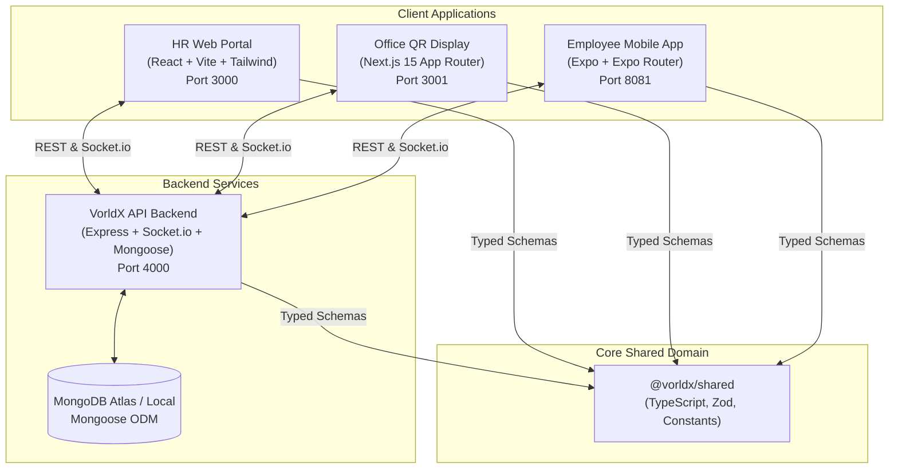

# VorldX Employee Attendance System

An enterprise full-stack attendance tracking, dynamic QR verification, and Work-From-Home (WFH) management system engineered for **VorldX Industries Private Limited** (CIN: `U62099UP2026PTC245598`).

---

## 🌐 Live Production Deployment & Service Registry

The system is deployed and operating live across cloud infrastructure:

| Tier / Application | Hosting Provider | Live Production URL | Operational Status |
| :--- | :--- | :--- | :--- |
| **HR & Admin Web Portal (Direct)** | Cloud Web Service | [https://attendance-tracker-56du.onrender.com](https://attendance-tracker-56du.onrender.com) | 🟢 **Live & Operational (Public / No SSO)** |
| **HR & Admin Web Portal (Vercel)** | Vercel Edge SPA | [https://attendance-tracker-apps-rehu9vems-kirtee.vercel.app](https://attendance-tracker-apps-rehu9vems-kirtee.vercel.app) | 🟢 **Live & Operational** |
| **Office Dynamic QR Kiosk** | Vercel (Next.js 15) | [https://attendance-tracker-qq8u.vercel.app](https://attendance-tracker-qq8u.vercel.app) | 🟢 **Live & Operational (Verified)** |
| **Backend API & WebSockets** | Render (Node.js Service) | [https://attendance-tracker-56du.onrender.com](https://attendance-tracker-56du.onrender.com) | 🟢 **Live & Operational** |
| **Backend Health Check** | JSON Diagnostics | [https://attendance-tracker-56du.onrender.com/health](https://attendance-tracker-56du.onrender.com/health) | 🟢 **HTTP 200 OK** |
| **Cloud Database** | MongoDB Atlas Multi-AZ | `vorldx-cluster.fgdib2g.mongodb.net` | 🟢 **Connected & Seeded** |
| **Source Code Repository** | GitHub | [https://github.com/kirteebhat/Attendance-Tracker](https://github.com/kirteebhat/Attendance-Tracker) | 🟢 **Public / Active** |

---

## 🔑 Demo Credentials for Live Evaluation

| Role | Username / Identifier | Password | Access Capabilities |
| :--- | :--- | :--- | :--- |
| **Platform Super Admin** | `admin@vorldx.demo` | `Admin@VorldX2026!` | Full HR portal, company policies, holidays, terminal pairing & revocation, audit logs. |
| **HR Operations Manager** | `hr@vorldx.demo` | `Hr@VorldX2026!` | Employee directory, live punch ledger, punch corrections with mandatory reasons, WFH approvals. |
| **Pre-Registered Employee** | `VX-001` (Aarav Sharma) | `Employee@2026!` | Instant mobile login, QR attendance scan, monthly statistics, WFH requests. |
| **Pre-Registered Employee** | `VX-002` (Priya Patel) | `Employee@2026!` | Mobile login, attendance history calendar, shift details. |
| **Unregistered Employee** | `VX-003` (Rohan Verma) | *(Set during registration)* | Demonstrates 3-step mobile registration flow (ID lookup → Simulated OTP → Set Password). |

---

## 1. System Architecture & Topology

The system is architectured as an **npm workspaces monorepo** decoupling the backend API, user-facing client applications, and shared domain models into dedicated packages:



---

## 2. Monorepo Workspaces & Tech Stack

| Workspace | Technology | Role & Responsibilities |
| :--- | :--- | :--- |
| [`packages/shared`](file:///c:/Attendance%20Tracker/packages/shared) | TypeScript, Zod | Source of truth for entity types, Zod validation schemas, attendance state enums, error codes, and real-time Socket.io event definitions. |
| [`apps/api`](file:///c:/Attendance%20Tracker/apps/api) | Node.js, Express, Socket.io, Mongoose, Vitest | Long-running backend handling dynamic QR HMAC signing, server-side punctuality evaluation, atomic attendance operations, WFH workflows, and real-time room broadcasts. |
| [`apps/web`](file:///c:/Attendance%20Tracker/apps/web) | React, Vite, Tailwind CSS, TanStack Query | HR/Admin portal for real-time attendance feeds, employee directory management, WFH approvals, terminal pairing, and audit logs. |
| [`apps/display`](file:///c:/Attendance%20Tracker/apps/display) | Next.js 15 (App Router), Lucide React, Canvas QR | Office kiosk display rendering dynamically rotating (30s) signed QR codes with an animated radial countdown ring. |
| [`apps/mobile`](file:///c:/Attendance%20Tracker/apps/mobile) | Expo, Expo Router, React Native, Camera | Employee mobile attendance app featuring simulated OTP account verification, camera/instant demo QR punch, WFH submission, and personal stats. |

---

## 3. Cryptographic Security & Anti-Fraud Architecture

To prevent attendance fraud (such as photo-sharing, relay attacks, and offline clock manipulation), the system enforces a zero-trust cryptographic pipeline:

1. **Short-Lived Dynamic QR Rotation (30s)**:
   The office display terminal requests a signed challenge token every 30 seconds (`/api/v1/display/challenge`). The token payload encodes:
   ```json
   {
     "terminalId": "term_lko_01",
     "nonce": "a7b3c9...",
     "expiresAt": 1774312830000,
     "signature": "hmac_sha256(terminalId + nonce + expiresAt, server_secret)"
   }
   ```
2. **Server-Side Authoritative Timestamps**:
   The client phone **never** submits a local timestamp. The backend assigns `recordedAt = new Date()` from the NTP-synchronized server clock upon receiving the scan request.
3. **Replay & Concurrency Protection**:
   Dynamic nonces are validated once. Scanning an already-consumed or expired token results in `ERR_CHALLENGE_EXPIRED` or `ERR_INVALID_QR`.
4. **Instant Terminal Revocation**:
   When HR revokes or disables a display from the web portal, a WebSocket event (`display:status_changed`) instantaneously blanks the QR code on the physical monitor and wipes local credentials within 500ms.

---

## 4. Quickstart: Local Setup & Running

### Prerequisites
- **Node.js**: `>= 20.x` (verified on Node `v24.19.0`)
- **npm**: `>= 10.x`
- **MongoDB**: Standalone or MongoDB Atlas cluster (`>= 6.0`)

### Installation & Environment Configuration
```bash
# Clone the repository and enter the directory
git clone <repo-url>
cd attendance-tracker

# 1. Install dependencies across all monorepo packages
npm install

# 2. Setup environment variables from examples
cp apps/api/.env.example apps/api/.env
cp apps/web/.env.example apps/web/.env
cp apps/display/.env.example apps/display/.env
cp apps/mobile/.env.example apps/mobile/.env

# 3. Build shared packages and apps
npm run build

# 4. Seed database with initial employees, policies, displays, and demo attendance
npm run seed
```

### Starting the Applications
Run each service in separate terminal windows:

```bash
# Terminal 1: Backend API Server (Port 4000)
npm run dev:api

# Terminal 2: HR Web Portal (Port 3000)
npm run dev:web

# Terminal 3: Office QR Display Kiosk (Port 3001)
npm run dev:display

# Terminal 4: Employee Mobile App (Expo Metro Bundler, Port 8081)
npm run dev:mobile
```

---

## 5. Seeded Demo Accounts & Credentials

The database seeder populates the following verified accounts:

| Role | Identifier / Email | Password | Allowed Capabilities |
| :--- | :--- | :--- | :--- |
| **System Admin** | `admin@vorldx.com` | `Admin@VorldX2026!` | Full HR portal access, employee creation, policy updates, terminal revocation, audit logs. |
| **HR Manager** | `hr@vorldx.com` | `Hr@VorldX2026!` | Employee directory, attendance correction, WFH approvals, daily operations. |
| **Staff Member** | `staff@vorldx.com` | `Admin@VorldX2026!` | Display terminal pairing code entry and kiosk management. |
| **Pre-Registered Employee** | `VX-001` (Aarav Sharma) | `Employee@2026!` | Mobile login, instant QR scan, WFH submission, profile review. |
| **Pre-Registered Employee** | `VX-002` (Priya Patel) | `Employee@2026!` | Mobile login, attendance history, shift tracking. |
| **Unregistered Employees** | `VX-003` to `VX-010` | *(Set during registration)* | Demonstrates 3-step mobile registration flow (ID check → OTP → Set Password). |

---

## 6. End-to-End Demo Walkthrough Script

Follow these steps to demonstrate the critical end-to-end user workflows:

### Scenario A: New Employee Onboarding & Mobile Login
1. Open the mobile app at `http://localhost:8081` (or in Expo Go).
2. Tap **Register**, enter Employee ID `VX-003`, and tap Continue.
3. Observe the demo OTP displayed on the screen (`Demo verification OTP: XXXXXX`).
4. Enter the 6-digit code, create a password (`Employee@2026!`), and confirm registration.
5. Log in with `VX-003` and your newly created password.

### Scenario B: Dynamic QR Attendance Punch
1. Open the Office Display kiosk at `http://localhost:3001`.
2. Enter the active pairing code (default: `term_lko_01` pre-paired).
3. Observe the 30-second rotating QR code and animated countdown ring.
4. On the Mobile App, navigate to the **Scan** tab and scan the live QR code (or use instant demo punch).
5. Verify punch confirmation screen displays server-verified check-in time and status.
6. Check `http://localhost:3000` (HR Web): notice the attendance record appears live in the table via WebSockets without refreshing.

### Scenario C: Work-From-Home (WFH) Submission & Live Approval
1. On the Mobile App, open the **WFH** tab.
2. Select tomorrow's date, input reason (`Client onsite architectural consultation`), and tap **Submit Request**.
3. In the HR Web Portal (`http://localhost:3000/wfh`), see the new request appear in real-time.
4. Click **Approve**, enter optional notes, and confirm.
5. In the Mobile App, observe the status change from `PENDING` to `APPROVED` within 500ms via real-time WebSocket broadcast.

---

## 7. QA Verification & Test Execution

Run the complete test suite locally:

```bash
# Run all unit and integration tests across workspaces (152 tests)
npm run test

# Run the full 14-step end-to-end integration scenario (Section 11)
npm run test:e2e

# Run strict TypeScript typecheck across all 5 workspaces
npm run typecheck
```

### Test Results Summary
- **Unit & Integration Tests**: **152 / 152 Passing** (141 API + 11 Shared in ~64s).
- **14-Step E2E Workflow**: **14 / 14 Steps Passing** with 0 defects.
- **TypeScript Static Analysis**: **0 errors** across `@vorldx/shared`, `apps/api`, `apps/web`, `apps/display`, `apps/mobile`.
- See [`docs/TEST_REPORT.md`](file:///c:/Attendance%20Tracker/docs/TEST_REPORT.md) and [`docs/REQUIREMENTS_MATRIX.md`](file:///c:/Attendance%20Tracker/docs/REQUIREMENTS_MATRIX.md) for full audit evidence.

---

## 8. Technical Documentation Index

| Document | Description |
| :--- | :--- |
| [docs/PROJECT_REPORT.md](file:///c:/Attendance%20Tracker/docs/PROJECT_REPORT.md) | **Authoritative Final Project Report** covering all 35 requirements, architecture, security, and verification. |
| [docs/TEST_REPORT.md](file:///c:/Attendance%20Tracker/docs/TEST_REPORT.md) | Verbatim test outputs, code coverage, Section 11 test cases, and security assessment. |
| [docs/REQUIREMENTS_MATRIX.md](file:///c:/Attendance%20Tracker/docs/REQUIREMENTS_MATRIX.md) | Traceability matrix tracking all 35 requirements (`REQ-01` to `REQ-35`) with status and evidence. |
| [docs/DEPLOYMENT.md](file:///c:/Attendance%20Tracker/docs/DEPLOYMENT.md) | Step-by-step production deployment instructions for Atlas, Render, Vercel, and Expo EAS. |
| [docs/screenshots/README.md](file:///c:/Attendance%20Tracker/docs/screenshots/README.md) | Visual UI screenshot gallery covering 59 end-to-end application states. |
| [docs/ARCHITECTURE.md](file:///c:/Attendance%20Tracker/docs/ARCHITECTURE.md) | Topology, Monorepo package boundaries, and hosting specifications. |
| [docs/ATTENDANCE_STATE_MACHINE.md](file:///c:/Attendance%20Tracker/docs/ATTENDANCE_STATE_MACHINE.md) | Attendance statuses, transition matrix, punctuality rules, and edge cases. |
| [docs/QR_DESIGN.md](file:///c:/Attendance%20Tracker/docs/QR_DESIGN.md) | Dynamic QR HMAC signing, replay defenses, and pairing token protocol. |
| [docs/SOCKET_EVENTS.md](file:///c:/Attendance%20Tracker/docs/SOCKET_EVENTS.md) | Socket.io event signatures, room routing, and reconnection resync protocols. |
| [docs/API_CONTRACT.md](file:///c:/Attendance%20Tracker/docs/API_CONTRACT.md) | REST API endpoints, request/response schemas, and error codes. |
