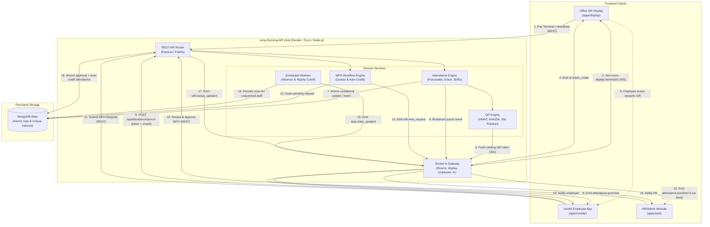

# System Architecture & Monorepo Design — VorldX Attendance System

This document specifies the architectural topology, monorepo workspace structure, data flows, and deployment strategy for the **VorldX Employee Attendance System**.

---

## 1. Monorepo Directory Layout

The codebase is organized as a unified, high-cohesion TypeScript monorepo managed via `pnpm` workspaces (or `npm`/`turborepo`). It cleanly decouples client applications from backend services while sharing data schemas, state machines, and cryptographic utilities.

```
attendance-tracker/
+-- apps/
|   +-- web/                   # VorldX Employee Website (HR / Admin Portal)
|   |   +-- app/               # Next.js App Router (dashboard, employees, WFH, policies, audit)
|   |   +-- components/        # Reusable Admin UI cards, tables, modals, analytics
|   |   +-- hooks/             # WebSocket subscriptions, data query hooks
|   |   +-- public/            # Static branding assets
|   |   +-- package.json
|   |   +-- tsconfig.json
|   |   +-- tailwind.config.ts
|   |
|   +-- display/               # Office QR Display Kiosk (Supporting system component)
|   |   +-- app/               # Next.js / Vite standalone fullscreen terminal route
|   |   +-- components/        # Dynamic QR canvas, countdown ring, pairing overlay
|   |   +-- hooks/             # Socket.io terminal listener & fallback polling
|   |   +-- package.json
|   |   +-- tsconfig.json
|   |
|   +-- mobile/                # VorldX Employee App (Mobile-first attendance & WFH)
|   |   +-- app/               # Responsive mobile views (scanner, today, history, stats, WFH)
|   |   +-- components/        # WebRTC camera scanner, quick punch simulator, metric cards
|   |   +-- hooks/             # Real-time punch listener, simulated OTP modal
|   |   +-- package.json
|   |   +-- tsconfig.json
|   |
|   +-- api/                   # Dedicated Backend & Real-time WebSocket Server
|       +-- src/
|       |   +-- config/        # Environment validation, database connection
|       |   +-- controllers/   # HTTP route handlers (auth, attendance, WFH, admin, terminals)
|       |   +-- models/        # Mongoose / MongoDB document models & compound indexes
|       |   +-- services/      # Business logic (attendance engine, QR signer, policy)
|       |   +-- sockets/       # Socket.io gateway, room handlers, reconnection logic
|       |   +-- cron/          # Scheduled workers (absence evaluation, overnight cutoff)
|       |   +-- middlewares/   # JWT auth, terminal auth, rate limiter, error handler
|       |   +-- server.ts      # Server bootstrap (HTTP + Socket.io)
|       +-- package.json
|       +-- tsconfig.json
|
+-- packages/
|   +-- shared/                # Universal Shared Library across all apps
|       +-- src/
|       |   +-- types/         # Domain interfaces (Employee, AttendanceRecord, Shift, Terminal)
|       |   +-- schemas/       # Zod validation schemas for requests and responses
|       |   +-- constants/     # Role enums, attendance statuses, socket events, colors
|       |   +-- state-machine/ # Pure attendance state machine and transition validators
|       |   +-- crypto/        # QR token HMAC generation, verification, and nonce utilities
|       |   +-- time/          # UTC to Asia/Kolkata dateKey converters and shift helpers
|       +-- package.json
|       +-- tsconfig.json
|
+-- docs/                      # Authoritative specifications, state machines, and reports
+-- package.json               # Root workspaces configuration
+-- pnpm-workspace.yaml        # Workspace package definitions
+-- tsconfig.base.json         # Base TypeScript compiler settings
```

---

## 2. High-Level Data Flow Diagram (Mermaid)

The following diagram illustrates the interactions between the three client modules, the long-running API/WebSocket server, and MongoDB Atlas.



---

## 3. Deployment & Hosting Strategy

The system is architected for maximum reliability, real-time WebSocket responsiveness, and zero-maintenance edge hosting:

```
+-----------------------------------------------------------------------------------------+
|                                      HOSTING PLAN                                       |
+-----------------------------------------------------------------------------------------+
|  Component             | Hosting Environment       | Rationale & Characteristics        |
+------------------------+---------------------------+------------------------------------+
| apps/api               | Long-Running Host         | Requires persistent TCP socket     |
| (Backend & WebSockets) | (Render, Railway, Fly.io, | connections for Socket.io rooms,   |
|                        | or AWS ECS)               | in-memory cron job timers for      |
|                        |                           | absence evaluation, and continuous |
|                        |                           | 30s QR rotation emission.          |
+------------------------+---------------------------+------------------------------------+
| apps/web               | Vercel                    | High-performance Next.js edge      |
| (HR/Admin Portal)      | (or Netlify / Cloudflare) | hosting with instant SSR, global   |
|                        |                           | CDN asset caching, and zero-cold-  |
|                        |                           | start administrative dashboard.    |
+------------------------+---------------------------+------------------------------------+
| apps/display           | Vercel                    | Static/SSR responsive kiosk web    |
| (Office QR Screen)     | (or Netlify / Cloudflare) | application running fullscreen in  |
|                        |                           | office terminal web browsers.      |
+------------------------+---------------------------+------------------------------------+
| apps/mobile            | Vercel / PWA              | Mobile-optimized web application   |
| (Employee Mobile App)  | (or Netlify / Cloudflare) | accessible via smartphone browsers |
|                        |                           | with camera WebRTC capabilities.   |
+------------------------+---------------------------+------------------------------------+
| Database               | MongoDB Atlas             | Managed MongoDB (M0 Free or M10)   |
| (Persistent Relational | (or Standalone MongoDB)   | utilizing atomic operations and    |
| Document Storage)      |                           | unique compound indexes without    |
|                        |                           | replica set transaction overhead.  |
+-----------------------------------------------------------------------------------------+
```

---

## 4. Architectural Boundaries & Data Flow Rules

1. **Backend Exclusivity for State Changes**:
   - Client applications never compute attendance status (`PRESENT`, `LATE`, `HALF_DAY`).
   - Timestamps sent by client clocks are strictly discarded; all punch timestamps are assigned by the backend server via `new Date()`.
2. **WebSocket as Accelerated Signaling, REST as Source of Truth**:
   - WebSockets provide instant UI feedback (token rotation, live punch feed, notifications).
   - If a client disconnects or loses network, it queries REST endpoints (`/api/attendance/today`, `/api/terminals/token`) to reconcile state immediately upon reconnection.
3. **Standalone MongoDB Compatibility**:
   - To guarantee frictionless local execution on developer machines and evaluation sandboxes, the architecture prohibits multi-document MongoDB transactions (`session.startTransaction()`).
   - All concurrency guarantees, idempotent punch handling, and duplicate defenses rely on atomic single-document updates (`findOneAndUpdate`, `$setOnInsert`) and unique compound indexes.
