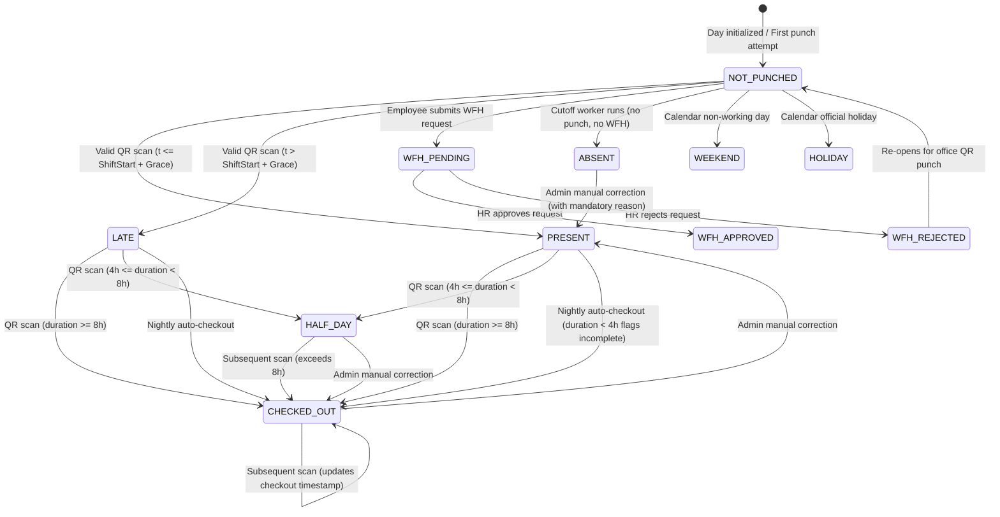

# Attendance State Machine Specification — VorldX Attendance System

This document provides the mathematical and operational specification for the attendance lifecycle, shift evaluations, punctuality rules, state transitions, and edge-case handling.

---

## 1. Time Normalization & Timezone Rules

To eliminate daylight saving errors, server clock drift, and local machine offsets, the system enforces a strict time normalization protocol:

1. **Storage Format**:
   - All timestamps (`checkInTime`, `checkOutTime`, `createdAt`, `updatedAt`) are stored strictly as **ISO 8601 UTC** (`Date` objects / UTC ISO strings in MongoDB).
2. **DateKey Derivation**:
   - The operational day for attendance is identified by a calendar string `dateKey` formatted as `YYYY-MM-DD`.
   - The `dateKey` is derived from UTC timestamps using the organization's **configured timezone** (Default: `Asia/Kolkata`, UTC+05:30).
   - Formula:
     $$\text{dateKey} = \text{formatInTimeZone}(\text{utcTimestamp}, \text{timezone}, \text{'yyyy-MM-dd'})$$
3. **Compound Key Uniqueness**:
   - MongoDB enforces single-record-per-day idempotency via a unique compound index:
     ```javascript
     db.attendance_records.createIndex({ employeeId: 1, dateKey: 1 }, { unique: true });
     ```

---

## 2. Attendance States

| State          | Semantic Meaning                                                                                        | Terminal State?        | Attendance Credit   |
| -------------- | ------------------------------------------------------------------------------------------------------- | ---------------------- | ------------------- |
| `NOT_PUNCHED`  | Default initial state for a scheduled working day prior to any punch.                                   | No                     | 0%                  |
| `PRESENT`      | Checked in at or before the shift start plus grace period threshold. Currently active in office.        | No (awaits checkout)   | 100%                |
| `LATE`         | Checked in after the grace period cutoff. Currently active in office.                                   | No (awaits checkout)   | 100% (Flagged Late) |
| `CHECKED_OUT`  | Employee completed work and successfully checked out with duration $\ge \text{min\_full\_day\_hours}$.  | Yes (for the day)      | 100%                |
| `HALF_DAY`     | Checked out with work duration $\ge \text{min\_half\_day\_hours}$ but $< \text{min\_full\_day\_hours}$. | Yes                    | 50%                 |
| `WFH_PENDING`  | Employee submitted a Work From Home request; awaiting HR review.                                        | No                     | 0% (in review)      |
| `WFH_APPROVED` | HR approved remote work. Excused remote presence credited.                                              | Yes                    | 100%                |
| `WFH_REJECTED` | HR rejected remote work. Reverts to `NOT_PUNCHED` for office presence.                                  | No                     | 0%                  |
| `ABSENT`       | Daily cutoff passed with no check-in punch and no approved WFH request.                                 | Yes (unless corrected) | 0%                  |
| `WEEKEND`      | Designated weekly rest day (e.g., Saturday, Sunday). Excluded from calculations.                        | Yes                    | Excluded            |
| `HOLIDAY`      | Official public/company holiday. Excluded from working day calculations.                                | Yes                    | Excluded            |

---

## 3. Allowed Transitions & Invalid Transition Error Catalog



### Invalid Transition Error Catalog

Every prohibited transition returns an unambiguous HTTP 400/409 error code and descriptive message:

| Current State         | Attempted Trigger                          | Resulting Error Code                   | Error Message & Rationale                                                                          |
| --------------------- | ------------------------------------------ | -------------------------------------- | -------------------------------------------------------------------------------------------------- |
| `PRESENT` or `LATE`   | Scan Check-In (attempting double check-in) | `ERR_ALREADY_CHECKED_IN` (409)         | _"Employee is already checked in for today. Your next scan will be processed as Check-Out."_       |
| `NOT_PUNCHED`         | Scan Check-Out (without checking in)       | `ERR_NO_ACTIVE_CHECKIN` (400)          | _"Cannot check out. No active check-in session found for this employee today."_                    |
| `CHECKED_OUT`         | Apply for WFH                              | `ERR_WFH_ALREADY_WORKED` (400)         | _"Cannot submit WFH request for a date where an office attendance record is already completed."_   |
| `PRESENT`             | Apply for WFH                              | `ERR_WFH_CURRENTLY_IN_OFFICE` (400)    | _"Cannot apply for Work From Home while currently punched in at the office."_                      |
| `WFH_APPROVED`        | Scan Office QR                             | `ERR_ALREADY_WFH_APPROVED` (409)       | _"Attendance already recorded as Work From Home for today. Contact HR if you wish to revoke WFH."_ |
| `WEEKEND` / `HOLIDAY` | Scan Office QR (overtime disabled)         | `ERR_NON_WORKING_DAY` (400)            | _"Today is a non-working weekend or company holiday. Office attendance is not required."_          |
| `ABSENT`              | Scan Check-In (after daily cutoff)         | `ERR_ATTENDANCE_WINDOW_CLOSED` (400)   | _"The attendance window for this date has closed. Please contact HR for a manual correction."_     |
| Any State             | Admin correction with empty reason         | `ERR_CORRECTION_REASON_REQUIRED` (400) | _"A non-empty justification reason is required for administrative attendance corrections."_        |

---

## 4. Late Rule & Grace Period Calculation

The attendance engine evaluates punctuality using server-side time arithmetic:

1. **Parameters**:
   - $\text{ShiftStart}$: Scheduled start time in local timezone (e.g., `09:00:00`).
   - $\text{GraceMinutes}$: Configurable grace window in minutes (Default: `15` minutes).
   - $\text{PunchTime}$: Server timestamp when valid QR scan is processed.
2. **Formula**:
   $$\text{GraceThreshold} = \text{ShiftStart} + (\text{GraceMinutes} \times 60 \text{ seconds})$$
   $$ \text{Status} = \begin{cases}
   \text{PRESENT}, & \text{if } \text{PunchTime} \le \text{GraceThreshold} \\
   \text{LATE}, & \text{if } \text{PunchTime} > \text{GraceThreshold}
   \end{cases}$$
   $$
3. **Punctuality Impact**:
   - `LATE` arrivals are recorded with `isLate: true` and `lateMinutes: round((PunchTime - ShiftStart) / 60)`.
   - In monthly metrics, `LATE` counts as a present day for attendance percentage, but increments the dedicated `lateArrivals` metric card.

---

## 5. Overnight Shift Handling

For shifts spanning past midnight (e.g., Night Shift: `22:00` to `06:00` next day):

1. **Shift Ownership & DateKey Assignment**:
   - An overnight shift is owned by the calendar date on which the shift **starts**.
   - Check-in window opens up to 60 minutes before start (e.g., `21:00`). Any punch between `21:00` (Day $D$) and `02:00` (Day $D+1$) assigns `dateKey = Day D`.
2. **Cross-Midnight Checkout Matching**:
   - When the employee scans the QR code at `06:00` on Day $D+1$, the server checks for an **open check-in session from the ongoing active shift** (`dateKey = Day D`).
   - Because the session is matched by active open status (`checkOutTime: null`) within the shift expiration window, the morning punch correctly closes Day $D$'s night shift rather than opening a premature check-in for Day $D+1$.

---

## 6. Missing Check-Outs & Nightly Auto-Close Worker

Employees who scan in the morning but forget to scan upon leaving the office are handled predictably:

1. **Scheduled Cutoff Worker**:
   - A background cron runs nightly at `04:00 AM local time` (or $\text{ShiftEnd} + 4\text{ hours}$).
2. **Atomic Incomplete Finalization**:
   - Queries all records where:
     ```javascript
     { dateKey: targetDateKey, checkInTime: { $ne: null }, checkOutTime: null }
     ```
   - Updates matching records atomically:
     ```javascript
     db.attendance_records.updateMany(
       { dateKey: targetDateKey, checkInTime: { $ne: null }, checkOutTime: null },
       {
         $set: {
           isMissingCheckout: true,
           status: "INCOMPLETE",
           durationMinutes: 0,
           systemNotes: "Auto-closed by scheduled worker: Missing checkout scan.",
         },
       }
     );
     ```
3. **Audit Visibility**:
   - Incomplete records appear on the HR Admin dashboard with an alert badge: _"Missing Checkout"_. HR can perform a manual correction with the verified departure time.

---

## 7. Work From Home (WFH) Lifecycle

1. **Submission**:
   - Employee submits a WFH request for Date $D$. Status becomes `WFH_PENDING`.
2. **Quota Check**:
   - Validates that approved WFH days in current calendar month $< \text{monthly\_wfh\_quota}$ (Default: 4 days).
3. **HR Decision**:
   - **Approval**: Status becomes `WFH_APPROVED`. The system atomically updates or inserts an `attendance_records` row for Date $D$ with `status: "WFH_APPROVED"`, `isWfh: true`, and `durationMinutes: 480`.
   - **Rejection**: Status becomes `WFH_REJECTED`. The employee must attend the office to record attendance.

---

## 8. Scheduled Absence Evaluation Worker

To prevent unpunched employees from remaining indefinitely in a phantom state:

1. **Execution Schedule**:
   - Runs every working day at $\text{ShiftStart} + 2 \text{ hours}$ (e.g., `11:00 AM`).
2. **Evaluation Logic**:
   - Retrieves all active employees assigned to the shift.
   - For each employee without an existing `attendance_records` document for today's `dateKey`:
     - Checks if an approved `WFHRequest` exists for today $\to$ If yes, creates `WFH_APPROVED`.
     - Checks if today is a company `Holiday` or weekend $\to$ If yes, skips.
     - Otherwise, executes an atomic upsert:
       ```javascript
       db.attendance_records.updateOne(
         { employeeId: emp._id, dateKey: todayDateKey },
         {
           $setOnInsert: {
             employeeId: emp._id,
             departmentId: emp.departmentId,
             dateKey: todayDateKey,
             status: "ABSENT",
             checkInTime: null,
             checkOutTime: null,
             durationMinutes: 0,
             createdAt: new Date(),
           },
         },
         { upsert: true }
       );
       ```
3. **Safety Guarantee**:
   - Because `$setOnInsert` only inserts if the document does not exist, an employee who scanned at `09:10 AM` will **never** be overwritten by the absence worker.
