# Database Architecture & Entity-Relationship Model — VorldX Attendance System

This document specifies the MongoDB document schema, relational references, embedded structures, index optimization, and data integrity constraints for the **VorldX Employee Attendance System**.

---

## 1. Entity-Relationship (ER) Diagram (Mermaid)

```mermaid
erDiagram
    EMPLOYEE ||--o| USER : "authenticates via"
    EMPLOYEE ||--o{ ATTENDANCE_RECORD : "records daily punches"
    EMPLOYEE ||--o{ WFH_REQUEST : "submits"
    EMPLOYEE ||--o{ QR_CHALLENGE : "redeems"
    EMPLOYEE ||--o{ REGISTRATION_OTP : "verifies with"
    ATTENDANCE_POLICY ||--|{ SHIFT : "embeds active shifts"
    EMPLOYEE }o--|| SHIFT : "assigned to"
    ATTENDANCE_RECORD ||--o| ORIGINAL_VALUES : "embeds unedited history"
    QR_DISPLAY ||--o{ QR_CHALLENGE : "generates nonces for"
    USER ||--o{ AUDIT_EVENT : "performs"
    USER ||--o{ WFH_REQUEST : "reviews"
    USER ||--o{ ATTENDANCE_RECORD : "corrects"

    EMPLOYEE {
        ObjectId _id PK
        string employeeId UK "Unique, e.g. VX-1001"
        string name
        string email UK "Unique, lowercase"
        string department "Indexed"
        string designation
        string workType "FULL_TIME | PART_TIME | CONTRACT | INTERN"
        ObjectId shiftId FK "References embedded Shift"
        string joiningDate "YYYY-MM-DD"
        boolean isActive "Soft-delete flag, default true"
        Date createdAt
        Date updatedAt
    }

    USER {
        ObjectId _id PK
        string employeeId UK "Unique reference to Employee"
        string email UK
        string passwordHash
        string role "EMPLOYEE | HR_ADMIN"
        string status "ACTIVE | INACTIVE | PENDING_VERIFICATION"
        Date lastLoginAt
        Date createdAt
        Date updatedAt
    }

    ATTENDANCE_RECORD {
        ObjectId _id PK
        ObjectId employee FK "Indexed"
        string employeeId "Indexed"
        string department "Indexed"
        string dateKey "YYYY-MM-DD, Indexed"
        Date checkInTime "UTC"
        Date checkOutTime "UTC"
        int durationMinutes "Elapsed work minutes"
        string status "PRESENT | LATE | HALF_DAY | CHECKED_OUT | WFH_APPROVED | ABSENT"
        boolean isLate
        int lateMinutes
        boolean isMissingCheckout
        boolean isManuallyCorrected "Flagged on admin edit"
        string terminalId
        string systemNotes
        string correctionReason "Mandatory on manual edit"
        ObjectId correctedBy FK "User who made correction"
        Date correctedAt
        Date createdAt
        Date updatedAt
    }

    ORIGINAL_VALUES {
        Date checkInTime "Original uncorrected punch"
        Date checkOutTime "Original uncorrected punch"
        string status "Original status before edit"
        int durationMinutes
        boolean isLate
        int lateMinutes
    }

    ATTENDANCE_POLICY {
        ObjectId _id PK
        string name "Policy Name"
        string timezone "Default: Asia/Kolkata"
        int defaultGraceMinutes "Default: 15"
        float minFullDayHours "Default: 8"
        float minHalfDayHours "Default: 4"
        int monthlyWfhQuota "Default: 4"
        int qrRotationSeconds "Default: 30"
        int qrGraceSeconds "Default: 15"
        int punchCooldownMinutes "Default: 2"
        boolean allowOvertime "Default: false"
        int[] workdays "Default: [1,2,3,4,5] Mon-Fri"
        boolean isDefault
        Date createdAt
        Date updatedAt
    }

    SHIFT {
        ObjectId _id PK
        string name "e.g. General Day Shift"
        string startTime "HH:mm, e.g. 09:00"
        string endTime "HH:mm, e.g. 17:00"
        int graceMinutes "Default: 15"
        boolean isOvernight "Cross-midnight flag"
        boolean isActive
    }

    HOLIDAY {
        ObjectId _id PK
        string name
        string dateKey UK "YYYY-MM-DD, Unique"
        string description
        boolean isRecurring
        Date createdAt
        Date updatedAt
    }

    WFH_REQUEST {
        ObjectId _id PK
        ObjectId employee FK "Indexed"
        string employeeId "Indexed"
        string department "Indexed"
        string dateKey "YYYY-MM-DD, Indexed"
        string reason "Min 5, Max 500 characters"
        string status "PENDING | APPROVED | REJECTED | CANCELLED"
        ObjectId reviewedBy FK "Admin who approved/rejected"
        string reviewerRemarks
        Date reviewedAt
        Date createdAt
        Date updatedAt
    }

    QR_DISPLAY {
        ObjectId _id PK
        string terminalId UK "Unique, e.g. term_lko_01"
        string name
        string location
        string pairingCode UK "Sparse, e.g. VX-7842"
        Date pairingCodeExpiresAt
        boolean isPaired
        boolean isActive "Admin toggle"
        string status "ACTIVE | INACTIVE | UNPAIRED"
        string terminalSecret "Private HMAC signing key"
        int tokenEpoch "Revocation epoch"
        Date lastHeartbeat
        Date createdAt
        Date updatedAt
    }

    QR_CHALLENGE {
        ObjectId _id PK
        ObjectId employee FK
        string employeeId
        string qrNonce
        string terminalId
        Date redeemedAt
        Date createdAt "TTL Index: expiresAfterSeconds 120"
    }

    REGISTRATION_OTP {
        ObjectId _id PK
        string employeeId "Indexed"
        string email
        string hashedCode "Hashed OTP"
        Date expiresAt "TTL Index: expiresAfterSeconds 0"
        int attempts "Max 5"
        boolean isUsed
        Date createdAt
    }

    AUDIT_EVENT {
        ObjectId _id PK
        string entityType "ATTENDANCE_RECORD | WFH_REQUEST | EMPLOYEE | POLICY | TERMINAL"
        string entityId "Indexed"
        ObjectId performedBy FK "User who performed action"
        string performedByEmployeeId
        string action "Indexed"
        mixed previousValue "Pre-change state snapshot"
        mixed newValue "Post-change state snapshot"
        string reason "Mandatory admin rationale"
        Date timestamp "Indexed, immutable"
        mixed metadata
    }
```



---

## 2. Integrity Constraints & Critical Indexes

The following database indexes guarantee data integrity, race-condition safety, and high-performance querying on **standalone MongoDB** instances without requiring multi-document transactions:

### 2.1 Unique Constraints

| Collection           | Indexed Fields                    | Constraint Type              | Purpose                                                                                                                                               |
| -------------------- | --------------------------------- | ---------------------------- | ----------------------------------------------------------------------------------------------------------------------------------------------------- |
| `employees`          | `{ employeeId: 1 }`               | `unique: true`               | Prevents duplicate employee IDs across the organization.                                                                                              |
| `employees`          | `{ email: 1 }`                    | `unique: true`               | Guarantees unique email address per staff member.                                                                                                     |
| `users`              | `{ employeeId: 1 }`               | `unique: true`               | Restricts credentials to exactly one user account per employee.                                                                                       |
| `attendance_records` | **`{ employee: 1, dateKey: 1 }`** | **`unique: true`**           | **Guarantees an employee can have at most one attendance record per calendar date.** Prevents duplicate punch records under concurrent scan attempts. |
| `wfh_requests`       | **`{ employee: 1, dateKey: 1 }`** | **`unique: true`**           | **Prevents multiple conflicting WFH applications for the same calendar date.**                                                                        |
| `qr_challenges`      | **`{ employee: 1, qrNonce: 1 }`** | **`unique: true`**           | **Per-employee replay defense:** Prevents an employee from redeeming the same QR token payload more than once.                                        |
| `qr_displays`        | `{ terminalId: 1 }`               | `unique: true`               | Ensures unique terminal identifiers.                                                                                                                  |
| `qr_displays`        | `{ pairingCode: 1 }`              | `unique: true, sparse: true` | Prevents duplicate active pairing codes while ignoring unpaired/cleared codes.                                                                        |
| `holidays`           | `{ dateKey: 1 }`                  | `unique: true`               | Eliminates duplicate holiday calendar entries on the same date.                                                                                       |

---

### 2.2 Time-To-Live (TTL) Auto-Purge Indexes

| Collection          | Indexed Field | TTL Expiration            | Behavior                                                                                                                             |
| ------------------- | ------------- | ------------------------- | ------------------------------------------------------------------------------------------------------------------------------------ |
| `qr_challenges`     | `createdAt`   | `expireAfterSeconds: 120` | Dynamic QR redemption records are automatically purged by MongoDB 2 minutes after creation, keeping collection size tightly bounded. |
| `registration_otps` | `expiresAt`   | `expireAfterSeconds: 0`   | Registration OTP records are automatically purged the exact moment their `expiresAt` timestamp is reached.                           |

---

### 2.3 Query & Analytical Compound Indexes

| Collection           | Compound Index                                  | Query Pattern Supported                                               |
| -------------------- | ----------------------------------------------- | --------------------------------------------------------------------- |
| `attendance_records` | `{ dateKey: 1, department: 1, status: 1 }`      | HR dashboard summary counts and departmental daily rollups.           |
| `attendance_records` | `{ employeeId: 1, dateKey: -1 }`                | Employee personal attendance history and monthly metric aggregations. |
| `wfh_requests`       | `{ status: 1, dateKey: 1 }`                     | HR pending review queue and date filtering.                           |
| `audit_events`       | `{ entityType: 1, entityId: 1, timestamp: -1 }` | Complete chronological audit log inspection for a specific entity.    |
| `employees`          | `{ department: 1, isActive: 1 }`                | Roster filtering by active status and department.                     |

---

## 3. Historical Preservation & Manual Correction Architecture

To satisfy enterprise audit requirements, administrative corrections never overwrite historical attendance data:

```javascript
// Sample AttendanceRecord document after an administrative manual correction:
{
  "_id": ObjectId("6714b8a1c9201..."),
  "employee": ObjectId("6714a1f..."),
  "employeeId": "VX-1002",
  "department": "Engineering",
  "dateKey": "2026-10-20",

  // CURRENT ACTIVE VALUES (Post-Correction)
  "status": "PRESENT",
  "isLate": false,
  "lateMinutes": 0,
  "checkInTime": ISODate("2026-10-20T03:30:00.000Z"),
  "checkOutTime": ISODate("2026-10-20T11:30:00.000Z"),
  "durationMinutes": 480,

  // AUDIT & HISTORICAL PRESERVATION
  "isManuallyCorrected": true,
  "correctionReason": "Office QR display scanner rebooted during morning rush; arrival verified by CCTV log.",
  "correctedBy": ObjectId("6714a00..."), // Admin User ID
  "correctedAt": ISODate("2026-10-20T08:15:22.000Z"),

  // ORIGINAL UNEDITED PUNCH VALUES (IMMUTABLE SNAPSHOT)
  "originalValues": {
    "checkInTime": ISODate("2026-10-20T04:15:00.000Z"),
    "checkOutTime": null,
    "status": "LATE",
    "durationMinutes": 0,
    "isLate": true,
    "lateMinutes": 45
  },

  "createdAt": ISODate("2026-10-20T04:15:00.000Z"),
  "updatedAt": ISODate("2026-10-20T08:15:22.000Z")
}
```

Whenever a manual correction is executed:

1. If `isManuallyCorrected` is `false`, the record's existing punch times, status, and duration are frozen inside `originalValues`.
2. The current fields are updated to the corrected values.
3. An immutable `AuditEvent` is created recording the action, actor, old values, new values, timestamp, and mandatory justification reason.
