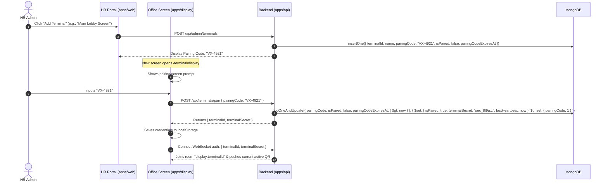

# Dynamic QR Code Security & Terminal Architecture — VorldX Attendance System

This document specifies the cryptographic token structure, terminal pairing protocol, multi-user replay defense, and revocation mechanics for the **Office QR Display** and **Employee Mobile App**.

---

## 1. Zero Sensitive Data Principle

The dynamic QR code displayed on office terminal screens is strictly a **time-bound location proof mechanism**. It contains **no confidential or personal information**:

- No employee identifiers, names, emails, or credentials.
- No database internal IDs or secrets.
- No administrative tokens or API keys.

An unauthorized person capturing a photograph of the screen obtains only an ephemeral, signed terminal challenge that expires within seconds.

---

## 2. Dynamic QR Token Anatomy & Cryptographic Signing

The QR payload is an ASCII JSON string (or base64url-encoded string) containing five lightweight fields:

```json
{
  "v": 1,
  "tid": "term_blr_hq_01",
  "ts": 1774092000,
  "exp": 1774092030,
  "n": "d7a4b89c31e2",
  "sig": "9f83ab2c4e1075f82d1b..."
}
```

### Field Definitions

| Field       | Key   | Type    | Description                                                                                 |
| ----------- | ----- | ------- | ------------------------------------------------------------------------------------------- |
| Version     | `v`   | Integer | Protocol schema version (default: `1`).                                                     |
| Terminal ID | `tid` | String  | Public identifier of the registered office display terminal.                                |
| Issued At   | `ts`  | Integer | Unix epoch timestamp (seconds) when token was minted.                                       |
| Expires At  | `exp` | Integer | Unix epoch timestamp (seconds) when token expires (`ts + 30s`).                             |
| Nonce       | `n`   | String  | 12-character cryptographically random hex string.                                           |
| Signature   | `sig` | String  | HMAC-SHA256 signature calculated over `v:tid:ts:exp:n` using the terminal's private secret. |

### Signature Generation & Verification

$$\text{PayloadString} = \text{`1:${tid}:${ts}:${exp}:${n}`}$$
$$\text{Signature} = \text{HMAC-SHA256}(\text{PayloadString}, \text{terminalSecret})$$

When the employee app submits the scanned payload to `POST /api/attendance/punch`:

1. The server fetches the `terminalSecret` for the given `tid`.
2. Computes the expected HMAC over `v:tid:ts:exp:n`.
3. Performs a constant-time comparison (`crypto.timingSafeEqual`) to prevent timing attacks.
4. Checks token freshness:
   $$\text{now} \le \text{exp} + \text{LATENCY\_GRACE\_SECONDS (15s)}$$
   $$\text{now} \ge \text{ts} - 5\text{s (clock drift tolerance)}$$

---

## 3. Dynamic Rotation Lifecycle (30–60 Seconds)

1. **Rotation Frequency**:
   - The backend QR generator rotates the active token every **30 seconds** (configurable between 30 and 60 seconds).
2. **Display Presentation**:
   - The Office QR Display renders the QR code with an animated SVG radial progress ring.
   - The ring counts down from 30 to 0 seconds.
   - At 0 seconds, the display transitions smoothly to the newly pushed token via WebSocket (`qr:token_rotate`).
3. **Grace Window**:
   - To accommodate employees who framed the QR code right before rotation or suffered minor mobile network latency, the backend accepts tokens up to **15 seconds** after their stated expiration.
   - Total effective token lifespan: $30\text{s} + 15\text{s} = 45\text{s}$.

---

## 4. Multi-Employee Scenarios & Per-Employee Replay Defense

### The Core Office Problem

In an office lobby, 15 employees stand in queue to enter. They scan the **same physical QR code** on the screen within a single 30-second rotation window.

- **Rule**: The QR token **cannot be globally single-use**, otherwise employee #1 scanning it would invalidate it for the other 14 employees behind them.
- **Security Requirement**: An individual employee must **not** be able to replay the exact same token multiple times or check in twice.

### Two-Tiered Atomic Replay Protection (Standalone MongoDB Compatible)

To enforce this without multi-document transactions, the backend employs two atomic database guarantees:

#### Tier 1: Per-Employee Nonce Redemption Log

A dedicated collection `qr_token_redemptions` tracks which employee redeemed which nonce:

```javascript
// Index definitions:
db.qr_token_redemptions.createIndex({ employeeId: 1, qrNonce: 1 }, { unique: true });

// Auto-expiring TTL index to keep storage bounded:
db.qr_token_redemptions.createIndex({ createdAt: 1 }, { expireAfterSeconds: 120 });
```

When an employee submits a scan, the backend executes an atomic insert:

```javascript
try {
  await db.collection("qr_token_redemptions").insertOne({
    employeeId: req.employee._id,
    qrNonce: payload.n,
    terminalId: payload.tid,
    redeemedAt: new Date(),
    createdAt: new Date(),
  });
} catch (err) {
  if (err.code === 11000) {
    throw new ApiError(
      409,
      "ERR_QR_REPLAY_DETECTED",
      "You have already scanned this specific QR token."
    );
  }
  throw err;
}
```

#### Tier 2: Atomic Attendance Record Constraints

Even if an employee bypassed Tier 1 using a newly rotated token 30 seconds later, the attendance record enforces single daily check-in:

```javascript
db.attendance_records.createIndex({ employeeId: 1, dateKey: 1 }, { unique: true });
```

- First scan executes an atomic `findOneAndUpdate` with conditional checks, transitioning state to `PRESENT` or `LATE`.
- Immediate re-scan within a 2-minute cooldown window is rejected with `ERR_PUNCH_COOLDOWN_ACTIVE` to prevent accidental double-taps.

---

## 5. Terminal Display Pairing & Authorization Flow



---

## 6. Instant Revocation & Terminal Deactivation

Admins have full command and control to invalidate displays in real-time:

1. **Instant Terminal Deactivation**:
   - Admin toggles `isActive: false` in the HR Portal.
   - Backend updates DB: `db.terminals.updateOne({ _id: tid }, { $set: { isActive: false } })`.
   - Backend emits `terminal:status_changed { isActive: false }` to room `display:tid`.
   - The display screen freezes immediately, blurring the QR code and displaying: _"Terminal Disabled by HR Admin"_.
   - Any punch submitted from that terminal is rejected with `ERR_TERMINAL_DISABLED` (403).
2. **Emergency Secret Rotation (Revocation)**:
   - Admin clicks "Revoke Secret & Re-pair".
   - The `terminalSecret` is regenerated, and `tokenEpoch` is incremented.
   - All previously generated QR tokens for that terminal become immediately invalid because their signatures fail verification.
