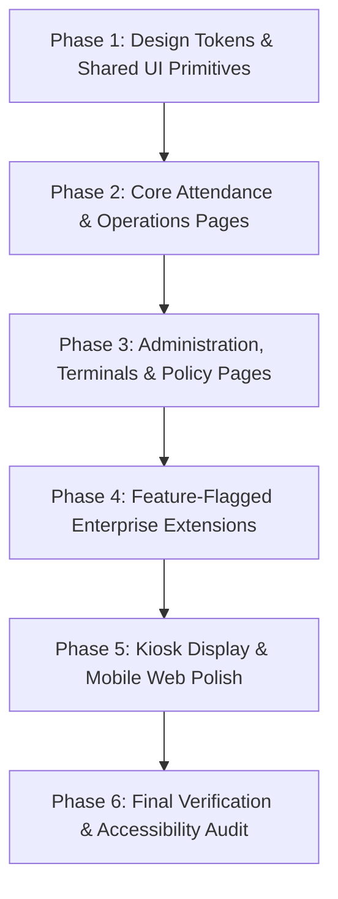

# VorldX UI Upgrade Plan & Regression Specification

> **Document Type:** Step-by-Step UI Architecture & Upgrade Roadmap  
> **Target Release:** VorldX Enterprise Suite v2.0 UI Upgrade  
> **Status:** Authoritative Implementation Plan  
> **Governing Document:** `docs/UI_UPGRADE_BRIEF.md`  

---

## 1. Upgrade Philosophy & Guardrails

1. **Strictly Additive Presentation Polish:**  
   No existing API endpoint, route path, database schema, role permission, or Socket.IO event handler will be altered. All work is confined to the presentation layer in `apps/web`, `apps/mobile`, and `apps/display`.
2. **Real Data Integrity:**  
   Every statistic, badge, table row, chart curve, and ticker message must bind exclusively to real database state returned by the existing backend.
3. **Inclusive & Resilient:**  
   Every component must respect `prefers-reduced-motion`, meet WCAG 2.1 AA contrast requirements, provide ARIA screen-reader descriptions, and gracefully render loading skeletons and error boundaries with retry mechanisms.

---

## 2. Phase-by-Phase Page Upgrade Roadmap

Items are organized strictly in order of **Priority** and **Risk**, from foundational primitives up to specialized views.



---

### Phase 1: Foundation & Shared UI Primitives
*Priority: Highest | Risk: Medium (High blast radius, affects all pages)*

1. **Shared Design Tokens & CSS Properties (`apps/web/src/styles/index.css`)**:
   - Ensure clean variable definitions for both Light Mode (`slate-50` / `white`) and Dark Mode (`slate-900` / `brand-950`).
   - Standardize focus ring tokens (`focus-visible:ring-2 focus-visible:ring-blue-500 focus-visible:outline-none`).
2. **Core Atomic Components (`apps/web/src/components/ui/`)**:
   - **`Button.tsx`**: Add smooth tactile active-press scaling (`active:scale-[0.98]`), accessible ARIA disabled states, and unified loading spinners.
   - **`Card.tsx`**: Harmonize elevation shadows (`shadow-card dark:shadow-none`), subtle borders (`border-slate-200 dark:border-slate-800`), and consistent inner paddings.
   - **`StatusBadge.tsx`**: Standardize all attendance status tokens with shared `@vorldx/shared` color mappings (Emerald for Present, Amber for Late, Rose for Absent, Indigo for WFH).
   - **`Modal.tsx` & `Drawer.tsx`**: Ensure keyboard focus trapping, Escape key dismissals, backdrop blur transitions (`backdrop-blur-sm`), and accessible `role="dialog"`.
   - **`EmptyState.tsx` & `ErrorState.tsx`**: Ensure clear icon illustrations, actionable text descriptions, and accessible retry triggers.
3. **Application Shell & Navigation (`apps/web/src/components/layout/`)**:
   - **`Sidebar.tsx`**: Polish active route pill indicator, badge counters (pending leave, unread announcements, open enquiries), collapsible mobile drawer transition.
   - **`Topbar.tsx`**: Integrate breadcrumb links, theme switcher button, live socket connectivity pill, and live HR presence indicator dropdown.

---

### Phase 2: Core Attendance & Operations Views
*Priority: High | Risk: Low (Self-contained business pages)*

1. **Executive Dashboard (`apps/web/src/pages/DashboardPage.tsx`)**:
   - **Metric Cards Grid**: Enhance 6 animated KPI cards (Active Staff, Present, Late, WFH, Not Punched, Rate) with icon badges and subtle hover lift.
   - **3D Hero Attendance Orb**: Polish dynamic multi-ring visual mapping to real percentage, and verify instant 2D SVG circular progress fallback.
   - **Today's Check-In Timeline (`TodayTimelineChart.tsx`)**: Refine Recharts hourly area chart with accessible tooltips and clear peak hour markers.
   - **Live Scan Stream (`LiveScanFeed.tsx`)**: Refine top-item entrance slide animation, pulsing green beacon, and filter chips (All, Check-In, Check-Out, Late).
   - **Department Attendance Breakdown (`DepartmentBars.tsx`)**: Refine horizontal bar progress charts with percentage badges.
2. **Attendance Ledger (`apps/web/src/pages/AttendanceLedgerPage.tsx`)**:
   - **Filters & Toolbar**: Accessible date picker, department dropdown, shift filter, search input with immediate visual feedback.
   - **Tabular Ledger**: Responsive table styling, sticky header, status badges, duration chips, check-in/out timestamps.
   - **Manual Punch Adjustment Drawer**: Clean correction drawer with mandatory justification remarks input and audit trail record.
3. **Employee Directory (`apps/web/src/pages/EmployeesPage.tsx`)**:
   - Search bar debounce, department category chips, employee profile cards with avatar initials.
   - Employee creation and edit modal with shift and work type selectors.
4. **Work From Home (WFH) Approvals (`apps/web/src/pages/WfhPage.tsx`)**:
   - Split view of Pending Requests vs Decision History.
   - Review drawer with employee profile details, justification reason, approve/reject buttons, and manager remarks text area.

---

### Phase 3: Administration, Terminals & Policy Views
*Priority: Medium | Risk: Low*

1. **Shift & Policy Configuration (`apps/web/src/pages/PoliciesPage.tsx`)**:
   - Visual shift schedule cards (Day, Morning, Night) with start time, end time, and grace period (15m).
   - Minimum working hours configuration with validation warnings against overlapping schedules.
2. **Office QR Displays & Terminals (`apps/web/src/pages/DisplaysPage.tsx`)**:
   - Terminal pairing status monitor (Online / Offline / Pending).
   - One-time pairing code modal with clean copy-to-clipboard button.
3. **Security & Session Management (`apps/web/src/pages/SecurityPage.tsx`)**:
   - Active staff session cards with IP address, browser/device user-agent, and last-active timestamp.
   - One-click remote session revocation and emergency force-logout confirmation.
4. **Compliance Audit Trail (`apps/web/src/pages/AuditLogsPage.tsx`)**:
   - Chronological audit events table with action type badges (`CORRECTION`, `OVERRIDE`, `POLICY_UPDATE`).
   - Collapsible before/after payload inspector.
5. **Reports & Data Export (`apps/web/src/pages/ReportsPage.tsx`)**:
   - Quick date range filters (Today, This Week, This Month, Custom).
   - CSV export trigger with direct file download.

---

### Phase 4: Enterprise Extension Pages (Behind Feature Flags)
*Priority: Medium | Risk: Low*

1. **Leave Management (`apps/web/src/pages/LeavePage.tsx`)**:
   - Leave balance visual summary cards (Casual, Sick, Earned, Unpaid).
   - Request review queue with status chips and approval drawer.
2. **Company Announcements (`apps/web/src/pages/AnnouncementsPage.tsx`)**:
   - Broadcast composer with markdown preview, priority chips (High, Normal, Low), and audience targeting.
   - Auto-generated template switchers with real variable interpolation.
3. **Support Enquiries & Helpdesk (`apps/web/src/pages/EnquiriesPage.tsx`)**:
   - Inbox view with status filters (Open, In Progress, Resolved, Closed).
   - Chat-style message thread with typing indicator and staff assignment.
4. **OTA Releases & Updates (`apps/web/src/pages/AppReleasesPage.tsx`)**:
   - Semantic version list, release notes display, forceUpdate banner simulation.
5. **Design System Showcase (`apps/web/src/pages/DesignSystemPage.tsx`)**:
   - Living documentation of all buttons, inputs, cards, dialogs, badges, and colors.

---

### Phase 5: Display Terminal & Mobile App Polish
*Priority: Low | Risk: Low*

1. **Office Display Kiosk (`apps/display`)**:
   - High-contrast fullscreen layout optimized for wall-mounted 1080p/4K monitors.
   - Smooth countdown circular ring (30s rotation), rotating QR code display, live office clock, and optional slim announcement ticker.
2. **Mobile App Views (`apps/mobile`)**:
   - Responsive web/native layout, status cards, camera scanner fallback, personal history calendar.

---

## 3. Repeatable Regression Checklist

Execute this comprehensive 6-step regression verification after every UI upgrade step:

```bash
# Step 1: Linting Check
npm run lint

# Step 2: Monorepo Typecheck
npm run typecheck

# Step 3: Core Automated Test Suite
npm run test

# Step 4: 14-Step End-to-End Workflow Verification
npm run test:e2e

# Step 5: Full Monorepo Production Build
npm run build

# Step 6: 3D, Accessibility & Motion Verification
node scripts/verify-3d-motion.js
```

### Manual Verification Checklist per Page:
- [ ] **Visual Layout:** No overlapping text, broken cards, or layout shifts.
- [ ] **Dark & Light Mode:** Text contrast meets WCAG AA (minimum 4.5:1) in both modes.
- [ ] **Real Data Binding:** No `mock_data`, `Math.random()`, or hardcoded counters.
- [ ] **Loading & Error Handling:** Shimmer skeletons render on fetch; errors show friendly retry UI.
- [ ] **Responsiveness:** Page adapts smoothly across Desktop ($\ge 1280\text{px}$), Tablet ($768\text{px}$–$1024\text{px}$), and Mobile ($< 640\text{px}$).
- [ ] **Reduced Motion:** If `prefers-reduced-motion` is enabled, all animations, transitions, and 3D scenes gracefully revert to static states.
- [ ] **Keyboard Navigation:** Tab key visits all interactive elements in logical order; active item has visible focus ring.

