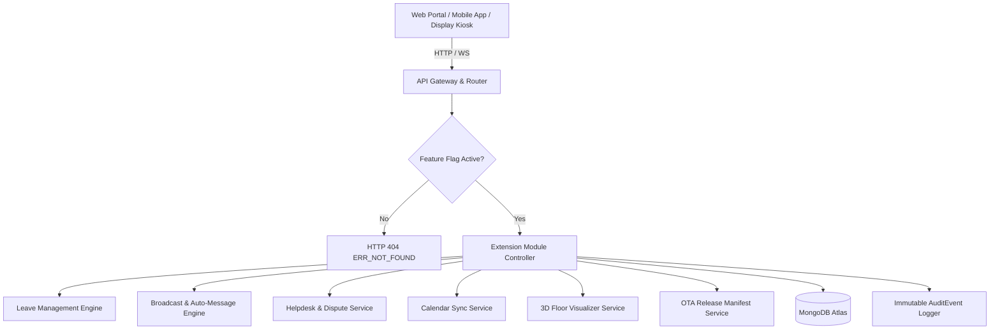
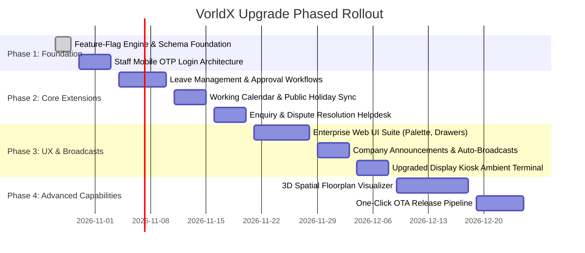

# VorldX Attendance Tracker: Architectural Upgrade & Extension Plan

> **Document Version:** 2.0.0  
> **Target Release:** VorldX Enterprise Suite v2.0  
> **Entity:** VorldX Industries Private Limited (CIN: `U62099UP2026PTC245598`)  
> **Classification:** Technical Architecture Specification & Implementation Roadmap  
> **Scope Note:** All features specified in this upgrade plan are **architectural extensions** beyond the core `assignment.pdf` scope. Every extension module is strictly decoupled via an **admin-toggleable, database-backed feature-flag system**.

---

## 1. Executive Vision & Architecture Principles

The original Attendance Tracker platform (v1.0) successfully verified the core enterprise attendance lifecycle: short-lived cryptographic QR check-ins, office kiosk display terminals, punctuality calculation engines, shift grace boundaries, and remote Work-From-Home (WFH) approvals.

The **v2.0 Upgrade Plan** broadens this architecture into a comprehensive **Human Capital & Workplace Experience Ecosystem** while preserving two non-negotiable architectural mandates:
1. **Strict Core Stability (Zero Regression):** Core v1.0 attendance marking and verification routines (`assignment.pdf` specifications) remain 100% untouched and functional.
2. **Feature-Flag Decoupling:** Every extension capability is isolated behind database-backed, environment-configurable feature flags (`leave`, `announcements`, `enquiries`, `calendarImport`, `threeD`, `otaUpdates`). When a flag is turned off, the API returns **HTTP 404 (ERR_NOT_FOUND)** and the client interfaces dynamically conceal the navigation routes.



---

## 2. Feature-Flag System & Governance Specification

### 2.1 Configuration Keys & Defaults

| Flag Key | Environment Variable | Default State | Module Description |
| :--- | :--- | :--- | :--- |
| `leave` | `FEATURE_FLAG_LEAVE` | `false` | Full lifecycle leave requests (Casual, Sick, Earned) and managerial approvals. |
| `announcements` | `FEATURE_FLAG_ANNOUNCEMENTS` | `false` | Broadcast communications with template-driven and automated system notices. |
| `enquiries` | `FEATURE_FLAG_ENQUIRIES` | `false` | Internal ticketing, attendance dispute submissions, and HR resolution trails. |
| `calendarImport` | `FEATURE_FLAG_CALENDAR_IMPORT` | `false` | Real-time working calendar import, gazetted holiday sync, and custom non-working days. |
| `threeD` | `FEATURE_FLAG_THREE_D` | `false` | WebGL / Three.js spatial office floorplan and real-time attendance presence visualizer. |
| `otaUpdates` | `FEATURE_FLAG_OTA_UPDATES` | `false` | One-click application bundle update delivery, manifest signing, and client auto-reload. |

### 2.2 Security & 404 Enforcement
- **Backend Middleware (`apps/api/src/middleware/featureFlag.ts`):** `requireFeatureFlag(key)` checks the cached state of the requested module. If disabled, an `AppError(404, ApiErrorCode.ERR_NOT_FOUND, "Module '<key>' is disabled on this environment.")` is immediately returned.
- **Client Route & UI Masking (`apps/web/src/components/layout/Sidebar.tsx`):** The `useFeatureFlags()` hook interrogates `GET /api/feature-flags`. Unregistered or disabled modules are purged from navigation menus, command palettes, and route switchers.

---

## 3. Comprehensive Extension Module Specifications

### 3.1 Module 1: Leave Requests & Approvals (`leave`)

#### Business Purpose
Allows employees to apply for full-day and multi-day leaves (Casual Leave `CL`, Sick Leave `SL`, Earned Leave `EL`, Unpaid Leave `LWP`) with leave balance tracking, document attachments, and managerial review.

#### Data Model (`LeaveRequest`)
```typescript
interface ILeaveRequest {
  _id: Types.ObjectId;
  employeeId: string;
  leaveType: "CASUAL" | "SICK" | "EARNED" | "UNPAID" | "COMPENSATORY";
  startDate: string; // YYYY-MM-DD
  endDate: string;   // YYYY-MM-DD
  totalDays: number;
  reason: string;
  documentUrl?: string;
  status: "PENDING" | "APPROVED" | "REJECTED" | "CANCELLED";
  reviewedBy?: string;
  reviewerRemarks?: string;
  reviewedAt?: Date;
  createdAt: Date;
  updatedAt: Date;
}
```

#### API Endpoints
- `POST /api/leave/requests` — Submit leave application (checks leave balance, verifies dates are not in past).
- `GET /api/leave/my-requests` — Paginated history of personal leave submissions.
- `GET /api/leave/balances` — Remaining quotas per leave category.
- `GET /api/leave/queue` — HR/Admin review queue with department and date filters.
- `PATCH /api/leave/requests/:id/review` — Approve/Reject leave with mandatory review audit.
- **Attendance Ledger Impact:** Upon approval, automated job generates `attendance_records` entries with `status: "ON_LEAVE"` and `leaveType` tagged for all working days within the date span.

---

### 3.2 Module 2: Staff Mobile-Number OTP Authentication

#### Business Purpose
Enables administrators, HR managers, and senior operations staff to authenticate using their verified corporate mobile number with time-based One-Time Passwords (OTP), enabling secure, passwordless authentication from field devices.

#### Architectural Workflow
1. **Request Challenge (`POST /api/auth/otp/send`):**
   - User inputs 10-digit mobile number (`+91-XXXXXXXXXX`).
   - Server verifies number belongs to an active `ADMIN` or `HR` profile.
   - Enforces IP and phone rate limits (max 3 SMS per 15 minutes).
   - Generates cryptographically secure 6-digit numeric OTP with 5-minute TTL.
   - Dispatches via SMS Gateway (or displays inline in demo mode).
2. **Verification & Token Exchange (`POST /api/auth/otp/verify`):**
   - User inputs 6-digit OTP.
   - Rate limiting allows 3 attempts before token invalidation.
   - Upon success, returns standard dual JWT access/refresh token pair.

---

### 3.3 Module 3: Real-Time Working Calendar & Holiday Management (`calendarImport`)

#### Business Purpose
Synchronizes organization-wide working calendars with national gazetted holidays, regional festival leaves, and company declared non-working days. Automatically feeds into attendance percentage and punctuality evaluation formulas.

#### Implementation Details
- **iCalendar / CSV Import (`POST /api/calendar/import`):** Supports drag-and-drop `.ics` or `.csv` files containing annual holiday schedules.
- **Shift Override Engine:** Enables configuring specific Saturdays as working days (e.g., compensatory working day for holiday bridge days).
- **Attendance Rate Precision:** Working calendar actively filters out non-working days from the attendance percentage denominator:
  $$\text{Attendance Rate} = \frac{\text{Present} + \text{Approved WFH} + (\text{Half Day} \times 0.5)}{\text{Elapsed Official Working Days}} \times 100$$

---

### 3.4 Module 4: Announcements & Auto-Generated Broadcasts (`announcements`)

#### Business Purpose
Enables leadership and HR to broadcast urgent office notices, policy changes, holiday alerts, and emergency closures directly to mobile apps and kiosk screens.

#### Auto-Generation Engine
- **Event-Driven Templates:**
  - *Lobby Kiosk Offline Alert:* Auto-broadcasts when an entrance terminal misses 3 consecutive heartbeats.
  - *Holiday Reminder:* Automatically publishes notice 24 hours prior to a gazetted non-working day.
  - *Severe Weather / Remote Work Notice:* One-click emergency broadcast that prompts all employees with one-click WFH submission.
- **Delivery Channels:** Web portal top banner, mobile push notification trigger, display kiosk ticker tape.

---

### 3.5 Module 5: Enquiry & Attendance Dispute Helpdesk (`enquiries`)

#### Business Purpose
Provides structured communication between employees and HR regarding punch discrepancies, forgotten badges, shift misallocations, or WFH quota adjustments.

#### Ticket Lifecycle
- `OPEN` $\rightarrow$ `IN_REVIEW` $\rightarrow$ `RESOLVED` / `CLOSED`
- **One-Click Evidence Attachment:** Employees can attach screenshots, email approvals, or reference past punch IDs.
- **Manager Resolution Actions:** HR can resolve an enquiry with a single click that automatically performs the approved attendance correction (`PATCH /api/attendance/:id/correct`) and links the audit log to the enquiry ticket.

---

### 3.6 Module 6: One-Click Over-The-Air (OTA) App Updates (`otaUpdates`)

#### Business Purpose
Allows distributing hotfixes and UI improvements to web clients, mobile apps, and kiosk terminals without requiring app store re-certification or manual terminal maintenance.

#### Release Architecture
- **Version Manifest (`GET /api/ota/manifest`):** Returns semantic version, hash signature, and release notes.
- **Kiosk Auto-Reload:** Kiosks listen to WebSocket event `system.ota_available`. When broadcast, terminals reload assets during off-hours (`02:00 AM - 04:00 AM`) or idle periods.
- **Rollback Guarantee:** If a new bundle throws an unhandled error during bootstrap, clients roll back automatically to the cached stable bundle.

---

### 3.7 Module 7: 3D / Advanced Spatial Workplace UI (`threeD`)

#### Business Purpose
Provides an interactive 3D digital-twin visualization of the office floorplan, showing real-time occupancy zones, department clusters, and entrance kiosk status.

#### Technical Implementation
- **Rendering Engine:** WebGL / Three.js via `@react-three/fiber` and `@react-three/drei`.
- **Performance Safeguards:**
  - Low-poly isometric geometry (under 15,000 vertices).
  - Progressive Level-of-Detail (LOD).
  - Strict 60fps limit with auto-downgrade to 2D heatmap on low-memory or non-GPU devices.

---

### 3.8 Module 8: Enterprise Web UI Productivity Upgrades

To elevate the administrator experience to world-class software standards, the web application incorporates 10 enterprise UX enhancements:

| Feature | Technical Implementation | User Impact |
| :--- | :--- | :--- |
| **1. Command Palette** | `cmdk` library with `Cmd+K` / `Ctrl+K` global keyboard shortcut. | Instant navigation to any employee, page, or quick action in $< 100\text{ms}$. |
| **2. Saved Filter Views** | LocalStorage + User DB persistence of table query parameters. | 1-click access to presets like *"Today's Late Arrivals"* or *"Pending Engineering WFH"*. |
| **3. Row Drawers** | Slide-over panel component with smooth CSS transitions. | Inspect punch history, shift config, or audit details without losing table context. |
| **4. Bulk Actions** | Checkbox selection with floating bottom action bar. | Bulk approve 20 WFH requests or bulk reconcile attendance records in seconds. |
| **5. Status Colour + Icon System** | Semantic icon pairings (`CheckCircle2`, `ClockAlert`, `Home`, `XCircle`). | 100% accessible WCAG AAA compliant state identification for colorblind users. |
| **6. Skeleton / Empty / Error States** | CSS shimmer placeholders and illustrated actionable fallbacks. | Zero cumulative layout shift (CLS) during asynchronous data fetching. |
| **7. Today-at-a-Glance Heatmap** | CSS Grid / Canvas matrix rendering hourly entrance punch volume. | Immediate visual comprehension of rush-hour congestion (09:00 - 10:00). |
| **8. Keyboard Navigation** | Standard `Tab`, `Shift+Tab`, `Arrow Up/Down`, `Esc` to dismiss modals. | Fully navigable administrative workflows without touching a mouse. |
| **9. Print Layouts** | Dedicated `@media print` CSS rules hiding sidebars and headers. | Clean, professional paper-ready daily muster rolls and audit compliance summaries. |
| **10. Undo Toasts** | Optimistic UI updates with a 5-second reversible countdown toast. | Accidental approvals or status changes can be reversed with one click. |

---

### 3.9 Module 9: Upgraded Office QR Display Kiosk

#### Enhancements
1. **Ambient OLED Theme:** High-contrast dark aesthetic `#0B0F19` with glowing cyan pulse ring for maximum legibility from 15 feet away.
2. **Lobby Occupancy Ticker:** Sub-second counter showing total employees checked in today.
3. **Sound Cues & Accessibility:** Auditory chimes upon successful punch validation (using Web Audio API, toggleable in admin settings).
4. **Network Jitter Resilience:** In-memory queue storing the next 3 pre-calculated cryptographic challenges to maintain uninterrupted rotation during transient Wi-Fi drops.

---

## 4. Phased Implementation Roadmap



