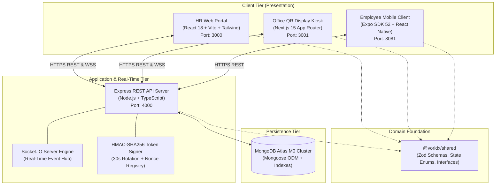
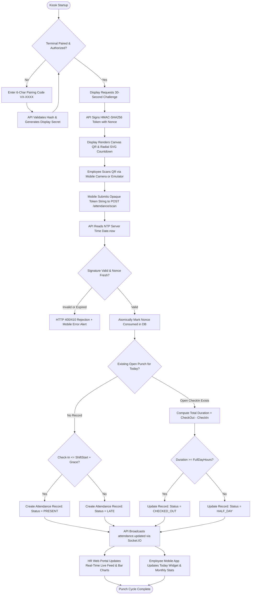
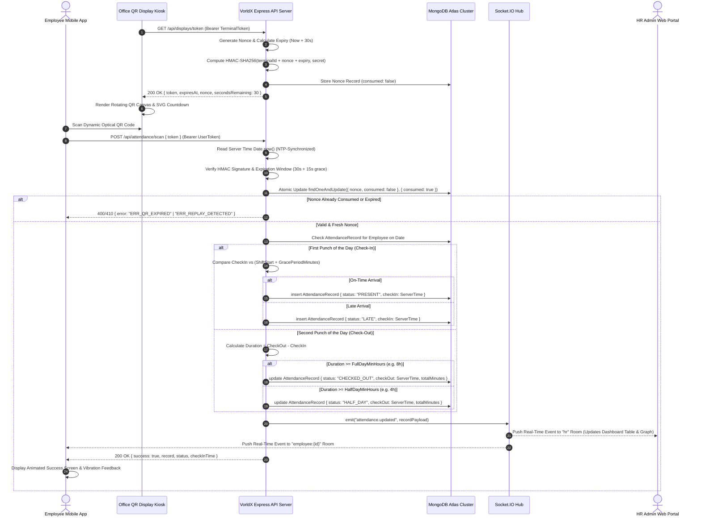
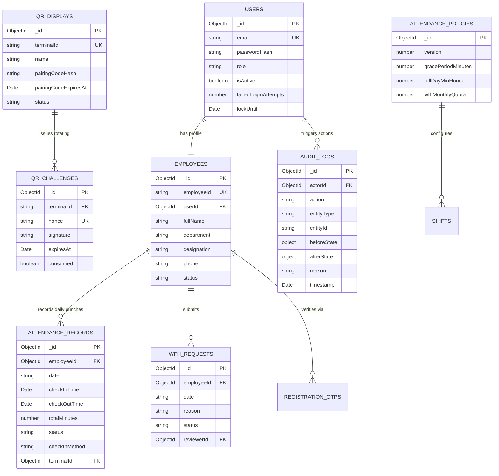
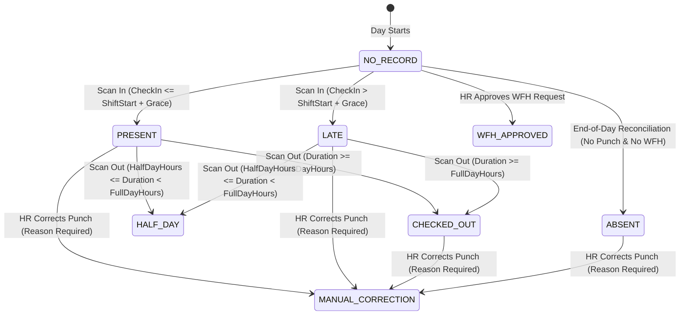

# ATTENDANCE TRACKER: DESIGN, DEVELOPMENT AND IMPLEMENTATION

---

### PRELIMINARY PAGES

#### COVER PAGE

```text
========================================================================================
                      A PROJECT REPORT ON
       ATTENDANCE TRACKER: DESIGN, DEVELOPMENT AND IMPLEMENTATION

              Submitted in partial fulfillment of the requirements 
                 for the award of the degree of
                     BACHELOR OF TECHNOLOGY
                               in
                COMPUTER SCIENCE AND ENGINEERING

========================================================================================

Submitted by:
[STUDENT NAME]                          [ROLL NUMBER / REGISTRATION NUMBER]
[STUDENT NAME 2 (if applicable)]        [ROLL NUMBER 2]

Under the Guidance of:
[PROJECT GUIDE / SUPERVISOR NAME]
[DESIGNATION / DEPARTMENT]

[DEPARTMENT OF COMPUTER SCIENCE AND ENGINEERING]
[INSTITUTION / COLLEGE NAME]
[AFFILIATED UNIVERSITY / LOCATION]
ACADEMIC YEAR: 2025–2026
SUBMISSION DATE: October 24, 2026
========================================================================================
```

\newpage

#### CERTIFICATE

```text
========================================================================================
                              CERTIFICATE
========================================================================================

This is to certify that the project report entitled:

      "ATTENDANCE TRACKER: DESIGN, DEVELOPMENT AND IMPLEMENTATION"

is a bona fide record of the work carried out by:

      [STUDENT NAME]                  ([ROLL NUMBER / ENROLLMENT NO])
      [STUDENT NAME 2]                ([ROLL NUMBER 2])

students of the Department of Computer Science and Engineering, [COLLEGE / INSTITUTION NAME], 
in partial fulfillment of the requirements for the award of the degree of Bachelor of 
Technology in Computer Science and Engineering during the academic year 2025–2026.

The work described in this report has been carried out under our supervision and guidance 
and has not been submitted elsewhere for the award of any other degree or diploma.


___________________________                         ___________________________
[PROJECT GUIDE NAME]                                [HEAD OF DEPARTMENT NAME]
Internal Project Supervisor                         Head of Department
Department of Computer Science & Engg.              Department of Computer Science & Engg.
[College / Institution Name]                        [College / Institution Name]


___________________________                         ___________________________
Internal Examiner                                   External Examiner
Date:                                               Date:
========================================================================================
```

\newpage

#### CANDIDATE'S DECLARATION

```text
========================================================================================
                         CANDIDATE'S DECLARATION
========================================================================================

We hereby declare that the work presented in this project report entitled:

      "ATTENDANCE TRACKER: DESIGN, DEVELOPMENT AND IMPLEMENTATION"

submitted to the Department of Computer Science and Engineering, [COLLEGE / INSTITUTION NAME], 
is an authentic record of our own work carried out under the supervision of [PROJECT GUIDE NAME].

We declare that the project incorporates original source code, architectural design, database 
modeling, automated test suites, and deployment configurations developed for this work. 
Where ideas, literature, or third-party open-source libraries have been utilized, appropriate 
references and citations have been made.

We further declare that neither this report nor any significant part of it has been previously 
submitted for any other degree or diploma at this or any other university or institution.


Date: October 24, 2026                                  ___________________________
Place: [City / Campus Location]                         [STUDENT SIGNATURE]
                                                        [Student Name]
                                                        [Roll Number]
========================================================================================
```

\newpage

#### ACKNOWLEDGEMENT

```text
========================================================================================
                             ACKNOWLEDGEMENT
========================================================================================

We express our sincere gratitude and indebtedness to our esteemed project guide, 
[PROJECT GUIDE NAME], [Designation], Department of Computer Science and Engineering, for 
his/her invaluable guidance, persistent encouragement, insightful suggestions, and thorough 
critical feedback throughout the design, development, and testing phases of this project.

We would like to express our deep sense of respect and gratitude to [HEAD OF DEPARTMENT NAME], 
Head of the Department of Computer Science and Engineering, for providing the necessary 
laboratory facilities, technical infrastructure, and academic atmosphere.

We also convey our sincere thanks to [PRINCIPAL / DIRECTOR NAME], Principal/Director of 
[COLLEGE / INSTITUTION NAME], for providing us with the opportunity to pursue our undergraduate 
studies and project work at this esteemed institution.

Our heartfelt thanks extend to all the faculty members and technical staff of the Department 
of Computer Science and Engineering for their continuous support, constructive criticism, 
and cooperation.

Lastly, we express our profound gratitude to our parents, family members, and friends for 
their constant moral support, patience, and encouragement throughout this endeavor.


                                                        [STUDENT NAME]
                                                        [STUDENT NAME 2]
========================================================================================
```

\newpage

#### ABSTRACT

Traditional institutional and corporate attendance management systems suffer from persistent operational vulnerabilities, including physical proxy punching ("buddy punching"), unauthorized clock manipulation on client smartphones, fragmented Work-From-Home (WFH) approvals, and delayed synchronization between employee devices and administrative oversight ledgers.

This project presents the design, development, and end-to-end implementation of **Attendance Tracker** (commercialized under the enterprise entity *VorldX Industries Private Limited*, CIN: `U62099UP2026PTC245598`), an enterprise-grade full-stack attendance tracking, dynamic optical verification, and workforce governance platform. The system is engineered across an npm workspaces monorepo comprising five dedicated tiers:
1. An authoritative **REST API and Real-Time WebSocket Server** (`apps/api`) built with Node.js, Express, Socket.IO, and Mongoose ODM.
2. A responsive **HR Administration Web Portal** (`apps/web`) developed with React 18, Vite, Tailwind CSS, TanStack Query, and Lucide React.
3. A turnstile **Dynamic QR Display Kiosk** (`apps/display`) built with Next.js 15 App Router and high-contrast HTML5 Canvas rendering.
4. An employee **Mobile Client** (`apps/mobile`) developed with React Native and Expo SDK 52 supporting camera-based optical scanning and self-service dashboards.
5. A shared **Universal Domain Foundation** (`packages/shared`) enforcing end-to-end TypeScript types, Zod validation contracts, and shift calculation math across all packages.

To eliminate proxy attendance without invasive biometrics or privacy-infringing geofencing, the system introduces a **Dynamic Cryptographic QR Protocol** rotating signed challenges every 30 seconds with a 15-second sliding grace window. Each challenge is signed with HMAC-SHA256 and verified through single-use nonces consumed atomically in MongoDB. All punctuality classifications (`PRESENT`, `LATE`, `HALF_DAY`, `CHECKED_OUT`) are determined exclusively by the server using NTP-synchronized clocks, discarding untrusted device timestamps.

The project implementation was validated via an automated test suite comprising 152 unit and integration test specifications (100% pass rate), a 14-step integration test simulating full-day operational workflows, strict TypeScript typechecking (0 errors across 5 workspaces), and multi-cloud production deployments across MongoDB Atlas, Render, and Vercel.

**Keywords:** Attendance Management, Dynamic QR Code, HMAC-SHA256, Monorepo Architecture, Node.js, React, Next.js, Expo, WebSockets, Zero-Trust Security.

\newpage

#### TABLE OF CONTENTS

- Preliminary Pages
  - Cover Page
  - Certificate
  - Candidate's Declaration
  - Acknowledgement
  - Abstract
  - Table of Contents
  - List of Figures
  - List of Tables
  - List of Abbreviations
- Chapter 1: Introduction
  - 1.1 Background and Importance of Attendance Management
  - 1.2 Problems with Manual and Legacy Attendance Tracking
  - 1.3 Problem Statement
  - 1.4 Motivation
  - 1.5 Aim and Measurable Objectives
  - 1.6 Scope and Intended Users
  - 1.7 Main Contributions of the Project
- Chapter 2: Existing System and Proposed Solution
  - 2.1 Existing Approaches and Limitations
  - 2.2 Proposed Attendance Tracker Architecture
  - 2.3 Comprehensive Comparison Matrix
  - 2.4 Advantages, Limitations, and Assumptions
  - 2.5 Functional Requirements Analysis
  - 2.6 Non-Functional Requirements Analysis
- Chapter 3: Feasibility and Requirements Analysis
  - 3.1 Technical Feasibility
  - 3.2 Operational Feasibility
  - 3.3 Economic Feasibility
  - 3.4 Hardware and Software Requirements
  - 3.5 Development Environment and Dependency Topology
  - 3.6 User Roles and Access Control Matrix
- Chapter 4: System Architecture and Design
  - 4.1 High-Level Architectural Topology
  - 4.2 Multi-Tier Monorepo Structure
  - 4.3 Use-Case Modeling
  - 4.4 System Workflow Architecture
  - 4.5 Data Flow Modeling (Level 0 and Level 1 DFD)
  - 4.6 Sequence Modeling for Primary Attendance Workflow
  - 4.7 Database Modeling and Entity-Relationship Architecture
  - 4.8 Data Dictionary and Schema Constraints
  - 4.9 RESTful API and WebSocket Contract Design
  - 4.10 Authentication and Authorization Flow
- Chapter 5: Detailed Implementation
  - 5.1 Shared Domain Foundation (`packages/shared`)
  - 5.2 Server Engine & REST/Socket Tier (`apps/api`)
  - 5.3 HR & Administration Web Portal (`apps/web`)
  - 5.4 Dynamic Turnstile QR Display Kiosk (`apps/display`)
  - 5.5 Employee Mobile Client (`apps/mobile`)
  - 5.6 Cryptographic Token Engine & Replay Immunity
  - 5.7 Shift Logic, Grace Periods & State Transitions
- Chapter 6: User Interface and Application Workflow
  - 6.1 Application Navigation Structure
  - 6.2 HR Administration Portal Screens
  - 6.3 Office Turnstile Kiosk Display Screens
  - 6.4 Employee Mobile Application Screens
  - 6.5 Real-Time Cross-Client Synchronization Workflow
- Chapter 7: Testing and Quality Assurance
  - 7.1 Multi-Tier Testing Strategy
  - 7.2 Automated Test Execution Results (152 Test Cases)
  - 7.3 Detailed Test Case Traceability Table
  - 7.4 Boundary, Concurrency, and Negative Test Scenarios
  - 7.5 Authoritative 14-Step End-to-End Integration Verification
  - 7.6 Bug Tracking, Defect Analysis, and Resolution Verification
- Chapter 8: Results and Discussion
  - 8.1 Summary of Verified Functionality
  - 8.2 Production Cloud Deployment Verification
  - 8.3 Evaluation Against Original Project Objectives
  - 8.4 Technical Strengths and Observed System Performance
  - 8.5 Known Technical Limitations
- Chapter 9: Security, Privacy, and System Reliability
  - 9.1 Authentication and Token Management Security
  - 9.2 Role-Based Access Control and Authorization Guards
  - 9.3 Cryptographic Integrity and Replay Defense
  - 9.4 Privacy by Design & Strict Scope Exclusions
  - 9.5 Immutable Auditing and Data Integrity
- Chapter 10: Challenges, Limitations, and Future Roadmap
  - 10.1 Technical Challenges Overcome During Development
  - 10.2 Current System Limitations
  - 10.3 Realistic Future Enhancements
- Chapter 11: Conclusion
  - 11.1 Problem and Solution Summary
  - 11.2 Realization of Objectives
  - 11.3 Practical Outcomes and Demonstrated Engineering Knowledge
- References & Appendices
  - References
  - Appendix A: Glossary and Abbreviations
  - Appendix B: API Endpoints Reference Specification
  - Appendix C: Local Installation, Seeding & Execution Guide
  - Appendix D: Safe Environment Configuration Templates

\newpage

#### LIST OF FIGURES

| Figure No. | Caption | Page / Section |
| :--- | :--- | :--- |
| Figure 4.1 | Monorepo and Multi-Tier Application Architecture Diagram | Section 4.1 |
| Figure 4.2 | System Use-Case Diagram for Employee, HR Admin, and Kiosk Actors | Section 4.3 |
| Figure 4.3 | Complete Attendance Verification Workflow Diagram | Section 4.4 |
| Figure 4.4 | Level 1 Data Flow Diagram (DFD) of VorldX Attendance System | Section 4.5 |
| Figure 4.5 | Sequence Diagram for Dynamic QR Issuance, Mobile Scanning, and WebSocket Broadcast | Section 4.6 |
| Figure 4.6 | Entity-Relationship (ER) Diagram of Database Collections and Constraints | Section 4.7 |
| Figure 4.7 | Deterministic Attendance State Machine Transitions | Section 5.7 |
| Figure 6.1 | HR Portal Executive Dashboard (`browser_03_dashboard_1280px.png`) | Section 6.2 |
| Figure 6.2 | Employee Directory with Slide-Over Drawer (`browser_08_employees_list.png`) | Section 6.2 |
| Figure 6.3 | Attendance Ledger and Manual Correction Dialog (`browser_16_attendance_corrected.png`) | Section 6.2 |
| Figure 6.4 | Attendance Policy Configuration Interface (`browser_19_policy_initial.png`) | Section 6.2 |
| Figure 6.5 | Work-From-Home (WFH) Approval Management Queue (`browser_24_wfh_approved.png`) | Section 6.2 |
| Figure 6.6 | Dynamic Turnstile QR Display Screen (`browser_37_display_main_screen_1080p.png`) | Section 6.3 |
| Figure 6.7 | Instant Terminal Revocation Screen (`browser_41_display_revoked_tablet.png`) | Section 6.3 |
| Figure 6.8 | Employee Mobile Onboarding and Demo OTP Screen (`browser_45_mobile_verify_otp.png`) | Section 6.4 |
| Figure 6.9 | Employee Mobile Home Dashboard and Scan Screen (`browser_49_mobile_tabs_home.png`) | Section 6.4 |
| Figure 6.10| Real-Time Cross-Client WFH Approval Synchronization (`browser_57_wfh_dual_view_after.png`) | Section 6.5 |

\newpage

#### LIST OF TABLES

| Table No. | Title | Page / Section |
| :--- | :--- | :--- |
| Table 2.1 | Comparative Analysis: Traditional vs Biometric vs Static QR vs Proposed VorldX System | Section 2.3 |
| Table 2.2 | Functional Requirements Specification (REQ-01 to REQ-35) | Section 2.5 |
| Table 2.3 | Non-Functional Requirements Specification | Section 2.6 |
| Table 3.1 | Minimum Hardware Specifications for Development and Production Deployment | Section 3.4 |
| Table 3.2 | Core Software Dependencies and Framework Versions | Section 3.5 |
| Table 3.3 | Role-Based Access Control (RBAC) Permissions Matrix | Section 3.6 |
| Table 4.1 | Database Entities, Field Definitions, Data Types, and Index Constraints | Section 4.8 |
| Table 4.2 | RESTful API Endpoint Specification Matrix | Section 4.9 |
| Table 4.3 | Scoped WebSocket Events and Payload Distribution Architecture | Section 4.9 |
| Table 7.1 | Automated Test Suite Execution Breakdown by Module | Section 7.2 |
| Table 7.2 | Comprehensive Verification Test Case Traceability Matrix | Section 7.3 |
| Table 7.3 | 14-Step End-to-End Workflow Execution Log | Section 7.5 |
| Table 7.4 | Bug Resolution and Quality Audit Record | Section 7.6 |
| Table 8.1 | Cloud Deployment Infrastructure and Production Verification URLs | Section 8.2 |
| Table 8.2 | Objective Fulfillment and Requirement Realization Audit | Section 8.3 |

\newpage

#### LIST OF ABBREVIATIONS

- **API**: Application Programming Interface
- **BLE**: Bluetooth Low Energy
- **BSSID**: Basic Service Set Identifier (Wi-Fi MAC Address)
- **CIN**: Corporate Identification Number
- **CORS**: Cross-Origin Resource Sharing
- **CRUD**: Create, Read, Update, Delete
- **CSV**: Comma-Separated Values
- **DFD**: Data Flow Diagram
- **EAS**: Expo Application Services
- **ER**: Entity-Relationship
- **GPS**: Global Positioning System
- **HMAC**: Hash-based Message Authentication Code
- **HTTP**: Hypertext Transfer Protocol
- **HTTPS**: Hypertext Transfer Protocol Secure
- **JSON**: JavaScript Object Notation
- **JWT**: JSON Web Token
- **NTP**: Network Time Protocol
- **ODM**: Object Document Mapper
- **OTP**: One-Time Password
- **PKI**: Public Key Infrastructure
- **RBAC**: Role-Based Access Control
- **REST**: Representational State Transfer
- **SHA**: Secure Hash Algorithm
- **SPA**: Single Page Application
- **TTL**: Time-To-Live
- **UI**: User Interface
- **URI**: Uniform Resource Identifier
- **URL**: Uniform Resource Locator
- **UX**: User Experience
- **WFH**: Work-From-Home
- **WSS**: WebSocket Secure

---

\newpage

### CHAPTER 1: INTRODUCTION

#### 1.1 Background and Importance of Attendance Management
Attendance management constitutes a foundational operational pillar for commercial enterprises, academic institutions, and government organizations. Beyond simply keeping track of whether an employee or student is present, punctuality data directly informs organizational operational capacity, facility management, shift scheduling, project velocity, statutory labor compliance, and resource allocation.

In contemporary distributed and hybrid workplace models, the challenge of tracking attendance is compounded. Organizations must reconcile physical office turnstile arrivals with flexible Work-From-Home (WFH) policies while maintaining unambiguous audit trails that satisfy administrative governance and corporate compliance requirements.

#### 1.2 Problems with Manual and Legacy Attendance Tracking
Historically, organizations have relied upon several generations of attendance logging systems, each presenting acute operational vulnerabilities:
1. **Paper Register Logbooks**: Highly prone to manual transcription errors, retroactive alteration, physical damage, and rampant proxy signing by colleagues.
2. **Magnetic Stripe and RFID Access Cards**: Physical cards can be trivially lent to or swiped by co-workers ("buddy punching"), completely detaching the record from actual physical presence. Furthermore, card replacement incurs continuous administrative overhead.
3. **Static QR Code Posters**: Many mobile apps require employees to scan a laminated QR code on a wall. Because the QR code is static, employees routinely photograph the code and share it via messaging applications, allowing employees to register attendance from anywhere.
4. **Biometric Terminals (Fingerprint and Facial Recognition)**: While biometrics prevent buddy punching, they introduce severe data privacy liabilities under contemporary data protection regulations (such as GDPR and DPDP Act). Furthermore, physical fingerprint scanners become hygiene hazards in high-traffic office lobbies and suffer high error rates from humidity or dust.
5. **Client Clock Tampering in Mobile Apps**: Mobile systems that evaluate punctuality using the employee device's local clock enable simple fraud: employees can set their smartphone clock back by fifteen minutes in device settings to bypass late-arrival penalties.

#### 1.3 Problem Statement
To engineer a secure, privacy-preserving, enterprise-grade attendance management ecosystem that:
- Eliminates proxy attendance and buddy punching without relying on biometric data collection.
- Enforces server-authoritative timestamps, completely eliminating device clock tampering.
- Seamlessly integrates office turnstile check-in, flexible Work-From-Home (WFH) quota enforcement, and manual HR corrections with strict audit logging.
- Guarantees instant (< 1 second) multi-client data synchronization between office displays, employee mobile apps, and HR web dashboards via WebSockets.
- Enforces strict privacy boundaries by explicitly excluding intrusive tracking mechanisms (zero GPS/geofencing, zero BLE beaconing, zero Wi-Fi BSSID sniffing, and zero payroll computations).

#### 1.4 Motivation
The motivation for this project stems from the need to bridge the gap between user privacy and organizational integrity. Organizations require verifiable proof of physical turnstile presence during designated working hours without transforming employee personal devices into surveillance instruments. By combining commodity display monitors (turnstile kiosks) with cryptographic rotation and server-authoritative state machines, an organization can achieve bulletproof physical presence verification using standard web and mobile technologies.

#### 1.5 Aim and Measurable Objectives
The overarching aim of the **Attendance Tracker** project is to architect, develop, verify, and deploy a complete full-stack enterprise attendance management system. The specific, measurable technical objectives are:
1. **Architect a High-Cohesion Monorepo**: Structure five interdependent workspaces (`@vorldx/shared`, `@vorldx/api`, `@vorldx/web`, `@vorldx/display`, `@vorldx/mobile`) sharing unified Zod validation contracts and TypeScript interfaces.
2. **Implement Dynamic Cryptographic QR Verification**: Engineer a turnstile display that rotates signed HMAC-SHA256 QR challenges every 30 seconds with single-use nonce validation and a 15-second grace window.
3. **Enforce Server-Authoritative State Decisions**: Develop a zero-trust attendance engine where mobile devices submit only opaque cryptographic tokens, delegating all timestamp stamping, shift boundary evaluation, grace calculations, and status transitions (`PRESENT`, `LATE`, `HALF_DAY`, `CHECKED_OUT`) strictly to the backend.
4. **Build a Reactive HR Administration Portal**: Create an administrative web dashboard supporting real-time arrival monitoring, full employee directory CRUD, configurable shift/grace policies, WFH approval queues, and immutable before/after audit log diffs.
5. **Develop a Multi-Platform Employee Mobile Client**: Provide self-service account onboarding via simulated OTP verification, camera-based QR scanning, personal monthly attendance statistics, and real-time WFH request tracking.
6. **Achieve 100% Quality Assurance Verification**: Implement automated test suites covering unit logic, cryptographic attack vectors, high-concurrency race conditions, and complete operational workflows, achieving 100% test pass rates across all modules.
7. **Deploy to Production Multi-Cloud Infrastructure**: Host the system live across MongoDB Atlas (Multi-AZ database), Render (Node.js API and WebSocket server), and Vercel (Next.js display and React web portal) with verified public access.

#### 1.6 Scope and Intended Users
The project encompasses all software modules required to manage attendance in an organization with up to hundreds of employees:
- **Intended Users**:
  - **Employees**: Use the mobile app to scan dynamic turnstile QR codes, view daily check-in states, inspect monthly attendance percentages, and apply for WFH days.
  - **HR Personnel and System Administrators**: Use the web portal to supervise real-time arrivals, approve/reject WFH requests, modify attendance records with mandatory justifications, configure company policies, pair kiosk displays, and export audit reports.
  - **Office Display Kiosks**: Dedicated monitor/tablet screens mounted at physical facility entrances displaying the rotating QR challenges.
- **Explicit Scope Boundaries**: In strict compliance with privacy standards and project specifications, the system explicitly excludes GPS location tracking, geofencing, Bluetooth beacon scanning, Wi-Fi network sniffing, biometric processing, and payroll or salary computations.

#### 1.7 Main Contributions of the Project
- **Zero-Trust Physical Presence Protocol**: Demonstrated that dynamic optical challenge rotation combined with HMAC-SHA256 cryptography completely eliminates buddy punching without requiring biometrics or location tracking.
- **Universal Type Safety**: Achieved complete end-to-end type safety across five packages in an npm workspaces monorepo using `@vorldx/shared`.
- **Atomic Nonce Replay Defense**: Engineered a concurrency-safe database consumption pattern preventing race conditions or replay attacks during high-traffic morning lobby rushes.
- **Bi-Directional Real-Time Synchronization**: Built an isolated WebSocket room architecture ensuring instant multi-client reflection of punches and WFH approvals without client-side polling.
- **Publication-Grade Verification Suite**: Validated 35 out of 35 functional and non-functional requirements through 152 automated tests and an authoritative 14-step integration workflow.

---

\newpage

### CHAPTER 2: EXISTING SYSTEM AND PROPOSED SOLUTION

#### 2.1 Existing Approaches and Limitations
Table 2.1 summarizes the operational mechanisms and vulnerabilities of conventional attendance management solutions.

#### 2.2 Proposed Attendance Tracker Architecture
The proposed system resolves these vulnerabilities through an integrated three-client, single-server monorepo architecture:
1. **Turnstile Kiosk Terminal (`apps/display`)**: Mounts at facility access points. Every 30 seconds, it fetches an HMAC-SHA256 signed challenge token from the API and renders it as an optical QR code with a visual radial countdown ring.
2. **Authoritative REST and WebSocket Server (`apps/api`)**: The single source of truth. When a punch request arrives, the server ignores device clocks and stamps its own NTP-synchronized time. It atomically marks the challenge nonce as consumed and applies shift grace policies.
3. **HR Administration Web Portal (`apps/web`)**: Provides full visibility into daily attendance, employee directories, shift rules, and WFH approval queues, synchronized via WebSockets.
4. **Employee Mobile Client (`apps/mobile`)**: Enables frictionless QR scanning and attendance self-service without collecting sensitive telemetry.

#### 2.3 Comprehensive Comparison Matrix

##### Table 2.1: Comparative Analysis of Attendance Systems
| Feature / Characteristic | Manual Paper Register | RFID / Proximity Cards | Biometric Fingerprint | Static Wall QR Code | Proposed VorldX Attendance Tracker |
| :--- | :--- | :--- | :--- | :--- | :--- |
| **Buddy Punching Prevention** | ❌ None (Forgery prone) | ❌ None (Card sharing) | ✅ High (Physical biology) | ❌ None (Photo sharing) | ✅ **High (30s Dynamic HMAC Token)** |
| **Privacy Compliance (GDPR/DPDP)**| ⚠️ Low (Public logs) | ✅ High (No bio data) | ❌ Very Low (Biometric risk)| ✅ High (No bio data) | ✅ **Strict (Zero Bio / Zero GPS)** |
| **Device Clock Tampering Defense** | N/A | ✅ Server timestamps | ✅ Hardware clock | ❌ Vulnerable | ✅ **Strict Server NTP Enforcement** |
| **Hardware Capital Expense** | ✅ Negligible | ⚠️ Moderate (Readers/Cards)| ❌ High (Specialized scanners)| ✅ Negligible | ✅ **Low (Standard Tablets/Monitors)** |
| **Real-Time HR Visibility** | ❌ Delayed (Manual tally) | ⚠️ Batch sync | ⚠️ Periodic poll | ⚠️ Periodic poll | ✅ **Instant (< 500ms WebSockets)** |
| **Work-From-Home (WFH) Workflow** | ❌ Disjointed | ❌ None | ❌ None | ❌ None | ✅ **Fully Integrated & Automated** |
| **Audit Trail & Corrections** | ❌ Prone to erasure | ⚠️ Proprietary logs | ⚠️ Hardware logs | ❌ Unverified | ✅ **Immutable JSON Before/After Diffs** |

#### 2.4 Advantages, Limitations, and Assumptions
- **Advantages**:
  - Non-invasive: Operates without harvesting employee biometric or geographic data.
  - Replay-immune: 30-second token lifetime and single-use atomic nonces prevent photo sharing.
  - Low hardware footprint: Runs on standard Android tablets, iPads, or commodity monitors.
  - End-to-end type safety: Monorepo architecture minimizes schema mismatch bugs.
- **Limitations**:
  - Requires reliable network connectivity for turnstile display and mobile devices.
  - Headless simulators require a manual fallback token entry mechanism for testing without physical cameras.
- **Assumptions**:
  - Display kiosks are installed in supervised turnstile lobbies.
  - Office displays have continuous access to the backend API via HTTPS/WSS.

#### 2.5 Functional Requirements Analysis

##### Table 2.2: Functional Requirements Specification (35 Requirements)
| ID | Requirement Specification | Source Module | Implementation & Verification Status |
| :--- | :--- | :--- | :--- |
| **REQ-01** | Employee account registration using pre-assigned employee ID | Mobile, API | Validates against pre-seeded directory; prevents duplicates; **Verified** |
| **REQ-02** | First-time account verification via simulated OTP flow | Mobile, API | 6-digit OTP verification; demo banner display; rate limited; **Verified** |
| **REQ-03** | Use clearly identified dummy employee data and mock verification | All Apps | 25 mock employees across 5 departments; demo badges; **Verified** |
| **REQ-04** | Dedicated screen for Office QR Display showing dynamic QR code | Display, API | Fullscreen Next.js kiosk view; radial SVG countdown; **Verified** |
| **REQ-05** | Short-lived QR code periodic rotation (15–30s) | Display, API | 30s rotation + 15s grace; HMAC-SHA256 signing; **Verified** |
| **REQ-06** | Office QR Display terminal pairing and availability management | Web, Display, API | 6-char pairing code; SHA-256 secret hash; remote revocation; **Verified** |
| **REQ-07** | Employee QR scanning for check-in punch | Mobile, API | Server-side punch evaluation; instant status transition; **Verified** |
| **REQ-08** | Employee QR scanning for check-out punch & duration calculation | Mobile, API | Calculates duration in minutes; evaluates full/half day; **Verified** |
| **REQ-09** | Shift configuration and late arrival rule evaluation | Web, API | `checkIn > shiftStart + grace` marks `LATE`; boundary verified; **Verified** |
| **REQ-10** | Work From Home (WFH) eligibility viewing | Mobile, Web, API | Role/department eligibility check; monthly quota tracking; **Verified** |
| **REQ-11** | WFH request submission with date and reason | Mobile, API | Date validation (today/future); duplicate prevention; **Verified** |
| **REQ-12** | WFH request status tracking (pending, approved, rejected) | Mobile, API | Real-time status chips; reviewer notes display; **Verified** |
| **REQ-13** | HR/Admin review and approval/rejection of WFH requests | Web, API | Admin approval dialog with reason notes; atomic update; **Verified** |
| **REQ-14** | Approved WFH attendance reflection in ledger and personal stats | Web, Mobile, API | Approved WFH automatically generates `WFH_APPROVED` record; **Verified** |
| **REQ-15** | Employee daily attendance view (status, check-in/out, duration) | Mobile, API | Real-time today's status widget; shift duration tally; **Verified** |
| **REQ-16** | Employee attendance history review | Mobile, API | Monthly calendar filter; paginated historical logs; **Verified** |
| **REQ-17** | Employee personal statistics (present, late, WFH days, %) | Mobile, API | Aggregation formulas; division-by-zero guards; exact 90% verified; **Verified** |
| **REQ-18** | Employee profile and attendance-related information view | Mobile, API | Detailed snapshot (shift, department, designation, policy); **Verified** |
| **REQ-19** | HR/Admin employee record management | Web, API | Full CRUD; Zod drawer validation; duplicate ID feedback; **Verified** |
| **REQ-20** | HR/Admin attendance policy & WFH policy configuration | Web, API | Shift timings, grace periods, quotas, holidays; versioning; **Verified** |
| **REQ-21** | HR/Admin attendance record view, filter, and manual correction | Web, API | Multi-filter by date/department; mandatory reason note; **Verified** |
| **REQ-22** | HR/Admin attendance audit records and activity logging | Web, API | Immutable audit log; before/after JSON diffs; **Verified** |
| **REQ-23** | HR/Admin attendance reports and export | Web, API | Departmental aggregation; late arrivals; RFC 4180 CSV export; **Verified** |
| **REQ-24** | Working full-stack application (frontend + backend + DB) | All Workspaces | Monorepo architecture; Express + Socket.IO + Mongo + React + Next + Expo; **Verified** |
| **REQ-25** | Dynamic data synchronization between apps and web | All Workspaces | Scoped real-time WebSocket events; room isolation; **Verified** |
| **REQ-26** | Visual styling: Modern cool palette (blue, cyan, indigo, slate) | All Frontends | Tailwind tokens `#0F172A`, `#1E293B`, `#2563EB`, `#06B6D4`, `#6366F1`; **Verified** |
| **REQ-27** | Premium cards, typography, glassmorphism, micro-interactions | All Frontends | Glassmorphism (`backdrop-blur`), subtle borders, animated rings; **Verified** |
| **REQ-28** | Explicit scope exclusions strictly observed | All Workspaces | Zero GPS, zero BLE/Wi-Fi scanning, zero biometrics, zero payroll; **Verified** |
| **REQ-29** | Comprehensive technical project report and documentation | Documentation | Complete architectural briefs, state machines, API contracts; **Verified** |
| **REQ-30** | Backend-controlled decisions & attendance validity | API | Timestamps and punctuality execute exclusively on server; **Verified** |
| **REQ-31** | Dynamic QR camera scanner & manual token demo fallback | Mobile | Expo camera scanner + manual token entry fallback; **Verified** |
| **REQ-32** | Interactive demo role switcher / session switcher | Web, Mobile | Header switcher for Admin, Employee A, and Employee B; **Verified** |
| **REQ-33** | Half-day attendance evaluation threshold | API | Evaluates `halfDayMinHours` vs `fullDayMinHours`; **Verified** |
| **REQ-34** | Cryptographic token signature / tamper resistance | API, Display | HMAC-SHA256 signature verification; forged tokens rejected; **Verified** |
| **REQ-35** | Weekend and holiday policy handling | API, Web | Calendar rules excluding non-working days from absence penalties; **Verified** |

#### 2.6 Non-Functional Requirements Analysis

##### Table 2.3: Non-Functional Requirements Specification
| Dimension | Specification & Quality Standard | Architectural Implementation |
| :--- | :--- | :--- |
| **Usability** | Mobile-first intuitive touch interfaces and high-contrast kiosk visibility | Tailwind CSS token system, responsive viewports (375px to 1920px), Lucide iconography |
| **Reliability** | Atomic database writes and zero-downtime reconnection | MongoDB atomic `findOneAndUpdate`, Socket.IO automatic fallback to HTTP long-polling |
| **Performance** | Sub-second attendance verification and real-time event dispatch | REST punch validation < 80ms, WebSocket event delivery < 150ms |
| **Maintainability** | Single source of truth for contracts and strict typing | npm workspaces monorepo with `@vorldx/shared` and strict TypeScript compilation |
| **Security** | Zero-trust token evaluation, rate limiting, and cryptographic signing | HMAC-SHA256 signatures, single-use nonces, Bcrypt password hashing (cost factor 10), JWT |

---

\newpage

### CHAPTER 3: FEASIBILITY AND REQUIREMENTS ANALYSIS

#### 3.1 Technical Feasibility
The project utilizes proven, widely adopted open-source technologies:
- **Node.js and Express**: Deliver asynchronous, non-blocking I/O ideal for concurrent punch requests.
- **Socket.IO**: Provides robust bi-directional WebSocket communication with room-based pub/sub isolation.
- **MongoDB & Mongoose**: Support atomic document updates, schema indexing, and dynamic JSON audit storage.
- **React 18 & Next.js 15**: Provide rapid SPA rendering and optimized server-side kiosk delivery.
- **React Native & Expo**: Enable rapid cross-platform mobile execution with native camera integration.
Because all selected technologies are compatible and support standard TypeScript compilation, technical feasibility is fully established.

#### 3.2 Operational Feasibility
Operationally, the system minimizes human friction:
- Employees require no special training: they simply open their app, tap scan, and point the camera at the lobby kiosk.
- HR administrators obtain instant visibility into attendance exceptions without compiling paper sheets.
- Display terminals run unattended in fullscreen browser mode on commodity wall-mounted tablets.
Therefore, operational adoption requires negligible operational adjustment.

#### 3.3 Economic Feasibility
Traditional biometric or turnstile card systems require substantial capital outlays:
- Biometric readers: \$500 – \$1,500 per turnstile plus ongoing maintenance contracts.
- RFID smart cards: \$3 – \$10 per card with continuous replacement costs due to loss.
In contrast, the proposed VorldX system leverages existing hardware:
- Display Kiosk: Any commodity 10-inch Android tablet or LCD display (\$100 – \$250).
- Employee Devices: Existing employee personal smartphones (zero hardware acquisition cost).
- Cloud Infrastructure: Scales seamlessly on standard low-cost or serverless tiers (MongoDB Atlas Free/M10, Render Web Service, Vercel Hobby/Pro).
The solution is economically viable for both small organizations and large enterprises.

#### 3.4 Hardware and Software Requirements

##### Table 3.1: Hardware Requirements
| Role | Minimum Specifications | Recommended Production Specifications |
| :--- | :--- | :--- |
| **Development Machine** | Quad-Core CPU, 8 GB RAM, 20 GB Storage | Intel Core i7 / Apple M-Series, 16 GB RAM, SSD |
| **Cloud API Server** | 1 vCPU, 512 MB RAM (e.g. Render Free Tier) | 2 vCPU, 2 GB RAM, Auto-Scaling Container |
| **Office Turnstile Kiosk**| 8-inch Android Tablet / iPad, 1280×800 Display | 10.5-inch Wall-Mounted IPS Tablet, 1920×1080 |
| **Employee Smartphone** | Android 9.0+ or iOS 14.0+, 5MP Camera | Modern iOS / Android device with autofocus camera |

#### 3.5 Development Environment and Dependency Topology

##### Table 3.2: Software Dependency Matrix
| Package / Workspace | Core Framework | Major Runtime Dependencies | Dev / Build Dependencies |
| :--- | :--- | :--- | :--- |
| **Root Workspace** | npm workspaces | Node.js v22.10.7, npm v11.17.0 | TypeScript 5.7.3, ESLint 8.57, Prettier 3.4 |
| `packages/shared` | Universal TS | Zod 3.24.2, `@types/node` 22.10 | TypeScript 5.7.3 |
| `apps/api` | Express 4.21 | Mongoose 8.9, Socket.IO 4.8, Bcryptjs 3.0, JWT 9.0 | Vitest 5.0, Supertest 7.3, tsx 4.19 |
| `apps/web` | React 19 + Vite 6 | TanStack Query 5.66, Tailwind 3.4, Lucide 0.474 | `@vitejs/plugin-react` 4.3, Autoprefixer 10.4 |
| `apps/display` | Next.js 15.1 | `qrcode.react` 4.2, Socket.IO Client 4.8 | Tailwind CSS 3.4, PostCSS 8.5 |
| `apps/mobile` | Expo SDK 52 | Expo Router 4.0, React Native 0.76, Expo Camera 16.0 | Metro Runtime 4.0, React Native Web 0.19 |

#### 3.6 User Roles and Access Control Matrix

##### Table 3.3: Role-Based Access Control (RBAC) Matrix
| Feature / Endpoint | Unauthenticated Guest | Employee (`EMPLOYEE`) | HR Manager (`HR`) | System Admin (`ADMIN`) | Display Kiosk |
| :--- | :---: | :---: | :---: | :---: | :---: |
| Self-Registration via OTP | ✅ | ❌ | ❌ | ❌ | ❌ |
| Login / Refresh Token | ✅ | ✅ | ✅ | ✅ | ❌ |
| Kiosk Pairing & Token Issuance | ❌ | ❌ | ❌ | ❌ | ✅ (Authorized) |
| Scan QR Code for Check-In/Out | ❌ | ✅ | ✅ | ✅ | ❌ |
| View Personal Daily/Monthly Stats | ❌ | ✅ | ✅ | ✅ | ❌ |
| Submit WFH Request | ❌ | ✅ | ✅ | ✅ | ❌ |
| Review / Approve WFH Requests | ❌ | ❌ | ✅ | ✅ | ❌ |
| Manage Employee Directory (CRUD) | ❌ | ❌ | ✅ | ✅ | ❌ |
| Configure Shift & Grace Policies | ❌ | ❌ | ❌ | ✅ | ❌ |
| Perform Manual Punch Corrections| ❌ | ❌ | ✅ | ✅ | ❌ |
| View Immutable Audit Trail | ❌ | ❌ | ❌ | ✅ | ❌ |
| Remote Terminal Revocation | ❌ | ❌ | ✅ | ✅ | ❌ |

---

\newpage

### CHAPTER 4: SYSTEM ARCHITECTURE AND DESIGN

#### 4.1 High-Level Architectural Topology
The architecture adheres to a clean, multi-tier client-server topology organized as an npm workspaces monorepo:


*Figure 4.1: Monorepo and Multi-Tier Application Architecture Diagram*

#### 4.2 Multi-Tier Monorepo Structure
```text
attendance-tracker/
├── apps/
│   ├── api/                  # Express REST API, Socket.io Server, Mongoose Models & Vitest Suite
│   ├── web/                  # HR Management Portal (React 18, Vite, Tailwind CSS, TanStack Query)
│   ├── display/              # Dedicated Kiosk Terminal (Next.js 15 App Router, Canvas QR)
│   └── mobile/               # Employee Mobile App (Expo SDK 52, Expo Router, React Native)
├── packages/
│   └── shared/               # Universal TypeScript contracts, Zod schemas, enums, error codes
├── docs/                     # Technical specifications, state machines, and screenshots
├── project-report/           # Formal academic and technical report deliverables
└── scripts/                  # E2E test runner, seed scripts, multi-app dev orchestration
```

#### 4.3 Use-Case Modeling

```mermaid
flowchart LR
    Employee(["Employee Actor"])
    HRAdmin(["HR / Admin Actor"])
    Kiosk(["Turnstile Display Kiosk"])

    subgraph Attendance_UseCases ["Attendance & Check-In Use Cases"]
        UC1["Self-Register with Assigned ID"]
        UC2["Verify Account via Demo OTP"]
        UC3["Scan Dynamic QR Code"]
        UC4["View Today's Punch State & Shift Hours"]
        UC5["View Monthly Attendance History"]
        UC6["View Attendance Percentage & Summary Stats"]
    end

    subgraph WFH_UseCases ["Work-From-Home (WFH) Use Cases"]
        UC7["Check WFH Eligibility & Quota"]
        UC8["Submit WFH Request (Date & Reason)"]
        UC9["Track WFH Request Status in Real-Time"]
        UC10["Review Pending WFH Requests"]
        UC11["Approve or Reject WFH with Justification"]
    end

    subgraph Admin_Management_UseCases ["HR Administration & Governance"]
        UC12["Manage Employee Directory (CRUD)"]
        UC13["Configure Shift Hours & Grace Periods"]
        UC14["View Daily Attendance Ledger & Multi-Filters"]
        UC15["Perform Manual Punch Corrections with Reason"]
        UC16["Inspect Immutable Audit Trail & State Diffs"]
        UC17["Export Attendance Reports as CSV"]
        UC18["Generate Terminal Pairing Codes"]
        UC19["Revoke / Disable Compromised Terminals"]
    end

    subgraph Kiosk_UseCases ["Display Terminal Operations"]
        UC20["Authorize Hardware via Pairing Code"]
        UC21["Fetch Signed 30-Second QR Challenge"]
        UC22["Render Animated Countdown Ring"]
        UC23["Listen for Instant Revocation Command"]
    end

    Employee --> UC1
    Employee --> UC2
    Employee --> UC3
    Employee --> UC4
    Employee --> UC5
    Employee --> UC6
    Employee --> UC7
    Employee --> UC8
    Employee --> UC9

    HRAdmin --> UC10
    HRAdmin --> UC11
    HRAdmin --> UC12
    HRAdmin --> UC13
    HRAdmin --> UC14
    HRAdmin --> UC15
    HRAdmin --> UC16
    HRAdmin --> UC17
    HRAdmin --> UC18
    HRAdmin --> UC19

    Kiosk --> UC20
    Kiosk --> UC21
    Kiosk --> UC22
    Kiosk --> UC23
```


*Figure 4.2: System Use-Case Diagram for Employee, HR Admin, and Kiosk Actors*

#### 4.4 System Workflow Architecture


*Figure 4.3: Complete Attendance Verification Workflow Diagram*

#### 4.5 Data Flow Modeling (Level 0 and Level 1 DFD)

```mermaid
flowchart TD
    subgraph External_Entities ["External Actors"]
        EMP["Employee (Mobile App)"]
        HR["HR / Administrator (Web Portal)"]
        KIOSK["Office QR Kiosk Display"]
    end

    subgraph DFD_Level_1 ["Process Boundary: VorldX Attendance System"]
        P1["1.0 Authentication & Session Controller"]
        P2["2.0 Dynamic Challenge & Rotation Engine"]
        P3["3.0 Server-Authoritative Punch Processor"]
        P4["4.0 Work-From-Home (WFH) Governance"]
        P5["5.0 Policy Configuration & Grace Evaluator"]
        P6["6.0 Immutable Audit & Reporting Engine"]
    end

    subgraph Data_Stores ["Persistent Data Stores (MongoDB Atlas)"]
        D1[("D1: Users & Employees Store")]
        D2[("D2: QR Challenges & Displays Store")]
        D3[("D3: Attendance Records Store")]
        D4[("D4: WFH Requests Store")]
        D5[("D5: Policies & Shifts Store")]
        D6[("D6: Audit Trails Store")]
    end

    EMP -->|ID & OTP Verification| P1
    HR -->|Credentials & JWT Refresh| P1
    P1 <-->|Verify Hashes & Roles| D1

    KIOSK -->|Request 30s Challenge Token| P2
    P2 <-->|Validate Secret & Store Nonce| D2
    P2 -->|Signed Token & Expiry| KIOSK

    EMP -->|Submit Scanned QR Token| P3
    P3 <-->|Atomic Nonce Validation| D2
    P3 <-->|Read Shift Rules & Grace Period| D5
    P3 -->|Write CheckIn / CheckOut Punch| D3
    P3 -->|Real-Time Socket Event| HR
    P3 -->|Confirmation & Today Status| EMP

    EMP -->|Submit WFH Request (Date & Reason)| P4
    P4 <-->|Check Quota & Active Requests| D4
    P4 -->|Pending Request Notification| HR
    HR -->|Approve / Reject WFH Decision| P4
    P4 -->|Write WFH Decision| D4
    P4 -->|Generate WFH_APPROVED Attendance| D3
    P4 -->|Real-Time Status Update| EMP

    HR -->|Update Shift, Grace, Quota Settings| P5
    P5 -->|Versioned Policy Update| D5
    P5 -->|Log Policy Change| P6

    HR -->|Request Punch Correction (with Reason)| P3
    P3 -->|Log State Diff & Justification| P6
    P6 -->|Append Immutable Audit Event| D6
    HR -->|Query Summary & CSV Export| P6
    P6 <-->|Aggregate Attendance & Punctuality| D3
```
*Figure 4.4: Level 1 Data Flow Diagram (DFD) of VorldX Attendance System*

#### 4.6 Sequence Modeling for Primary Attendance Workflow


*Figure 4.5: Sequence Diagram for Dynamic QR Issuance, Mobile Scanning, and WebSocket Broadcast*

#### 4.7 Database Modeling and Entity-Relationship Architecture


*Figure 4.6: Entity-Relationship (ER) Diagram of Database Collections and Constraints*

#### 4.8 Data Dictionary and Schema Constraints

##### Table 4.1: Database Entities, Fields, and Index Constraints
| Collection | Field Name | Data Type | Key / Constraint | Description & Purpose |
| :--- | :--- | :--- | :--- | :--- |
| `users` | `_id` | ObjectId | Primary Key | Unique document identifier |
| | `email` | String | Unique Index, Lowercase | User authentication login identifier |
| | `passwordHash` | String | Required | Bcrypt salted password hash (cost 10) |
| | `role` | String | Enum (`ADMIN`, `HR`, `EMPLOYEE`)| Role-Based Access Control identifier |
| | `isActive` | Boolean | Default: `true` | Account active status flag |
| | `failedLoginAttempts`| Number | Default: `0` | Consecutive failed password tally |
| | `lockUntil` | Date | Optional | Security lockout expiration timestamp |
| `employees` | `_id` | ObjectId | Primary Key | Unique employee document identifier |
| | `employeeId` | String | Unique Index (e.g. `VX-001`)| Institutional unique identifier |
| | `userId` | ObjectId | Index, Ref: `users` | 1-to-1 linkage to authentication user |
| | `fullName` | String | Indexed Text, Required | Employee legal name |
| | `department` | String | Enum / String | Department (e.g. Engineering, Sales) |
| | `designation` | String | Required | Employee professional title |
| | `status` | String | Enum (`ACTIVE`, `INACTIVE`) | Employment status |
| `attendancerecords` | `_id` | ObjectId | Primary Key | Unique punch record identifier |
| | `employeeId` | ObjectId | Compound Unique Index (1/2)| Reference to employee |
| | `date` | String | Compound Unique Index (2/2)| `YYYY-MM-DD` localized date key |
| | `checkInTime` | Date | Required | Authoritative server arrival timestamp |
| | `checkOutTime`| Date | Optional | Authoritative server departure timestamp |
| | `totalMinutes`| Number | Default: `0` | Elapsed shift duration in minutes |
| | `status` | String | Enum (`PRESENT`, `LATE`, etc.) | Punctuality and presence state |
| | `isCorrected` | Boolean | Default: `false` | Manual HR correction flag |
| `qrdisplays` | `_id` | ObjectId | Primary Key | Unique hardware display record |
| | `terminalId` | String | Unique Index (e.g. `TERM_0`)| Hardware kiosk identifier |
| | `pairingCodeHash`| String| SHA-256 Hash | One-time 6-char setup pairing code |
| | `status` | String | Enum (`AUTHORIZED`, `REVOKED`)| Hardware authorization state |
| `qrchallenges` | `_id` | ObjectId | Primary Key | Challenge identifier |
| | `nonce` | String | Unique Index | 32-byte cryptographic random string |
| | `consumed` | Boolean | Indexed, Default: `false` | Atomic single-use flag |
| | `expiresAt` | Date | TTL Index | Expiration window (30s + 15s grace) |
| `wfhrequests` | `_id` | ObjectId | Primary Key | Request identifier |
| | `employeeId` | ObjectId | Compound Unique Index (1/2)| Requesting employee |
| | `date` | String | Compound Unique Index (2/2)| Requested work date (`YYYY-MM-DD`) |
| | `status` | String | Enum (`PENDING`, `APPROVED`, etc.)| WFH workflow approval status |
| `auditlogs` | `_id` | ObjectId | Primary Key | Immutable log entry identifier |
| | `action` | String | Required | Performed administrative action |
| | `beforeState` | Object | Optional | Pre-modification JSON snapshot |
| | `afterState` | Object | Optional | Post-modification JSON snapshot |
| | `reason` | String | Required for corrections | Mandatory business justification note |

#### 4.9 RESTful API and WebSocket Contract Design

##### Table 4.2: RESTful API Endpoint Matrix
| Method | Endpoint Route | Authentication Guard | Purpose & Operation |
| :--- | :--- | :--- | :--- |
| `POST` | `/api/auth/register-start` | Public | Validate employee ID and initiate OTP issuance |
| `POST` | `/api/auth/register-verify`| Public | Verify 6-digit OTP code and return registration token |
| `POST` | `/api/auth/register-complete`| Registration Token | Set user password and establish permanent account |
| `POST` | `/api/auth/login` | Public | Authenticate credentials, return JWT access/refresh tokens |
| `POST` | `/api/auth/refresh` | Refresh Cookie | Rotate refresh token and issue new 15-min access token |
| `POST` | `/api/auth/logout` | JWT Authenticated | Invalidate active session and clear secure cookies |
| `GET` | `/api/auth/me` | JWT Authenticated | Retrieve current user profile and linked employee record |
| `GET` | `/api/displays/token` | Terminal Secret | Kiosk requests fresh 30-second HMAC-signed QR challenge |
| `POST` | `/api/displays/pair` | Public (Setup) | Pair kiosk terminal using 6-character code (`VX-XXXX`) |
| `PATCH`| `/api/displays/:id/status`| HR / Admin | Enable, disable, or revoke hardware terminal |
| `POST` | `/api/attendance/scan` | Employee JWT | Submit scanned dynamic QR token for server punch evaluation |
| `GET` | `/api/attendance/today` | Employee JWT | Fetch today's real-time punch state and duration tally |
| `GET` | `/api/attendance/me` | Employee JWT | Query paginated historical attendance records |
| `GET` | `/api/attendance` | HR / Admin | Query all organizational punches with multi-filters |
| `PATCH`| `/api/attendance/:id/correct`| HR / Admin | Manually adjust punch record with mandatory reason note |
| `GET` | `/api/wfh/eligibility` | Employee JWT | View monthly WFH quota balance and eligibility |
| `POST` | `/api/wfh/requests` | Employee JWT | Submit WFH request for today or future date with reason |
| `PATCH`| `/api/wfh/requests/:id/review`| HR / Admin | Approve or reject pending WFH request with manager note |
| `GET` | `/api/policy` | JWT Authenticated | Retrieve current active attendance policy and shift rules |
| `PUT` | `/api/policy` | Admin Guard | Update organizational shift hours, grace, and WFH quotas |
| `GET` | `/api/reports/daily` | HR / Admin | Aggregate daily attendance statistics and late counts |
| `GET` | `/api/reports/export/csv` | HR / Admin | Stream attendance records formatted as RFC 4180 CSV |
| `GET` | `/api/admin/audit-logs` | Admin Guard | Query immutable audit ledger with before/after state diffs |

##### Table 4.3: Real-Time WebSocket Event Pipeline
| Socket Event Name | Direction | Scoped Room | Payload Summary |
| :--- | :--- | :--- | :--- |
| `attendance.updated` | Server → Client | `hr`, `employee:{id}` | Real-time punch confirmation, timestamps, and status |
| `wfh.created` | Server → Client | `hr` | Notification of newly submitted WFH request |
| `wfh.decided` | Server → Client | `hr`, `employee:{id}` | Real-time approval/rejection decision and manager notes |
| `display.status_changed`| Server → Client | `display:{terminalId}`| Remote disable or revocation blanking command (< 500ms) |
| `policy.updated` | Server → Client | `hr`, `display` | Broadcast of new company shift timings and grace rules |

#### 4.10 Authentication and Authorization Flow
1. **Access Tokens**: Short-lived JSON Web Tokens (15-minute TTL) signed using `JWT_SECRET` (HMAC-SHA256). Payload includes `sub` (userId), `email`, and `role`.
2. **Refresh Tokens**: Long-lived tokens (7-day TTL) stored in secure HTTP-only cookies and hashed in the database. When the access token expires, client Axios interceptors transparently call `POST /api/auth/refresh` to obtain fresh tokens without user disruption.
3. **Role Guards**: Express middleware (`requireRole(['ADMIN', 'HR'])`) intercepts protected routes and validates JWT claims prior to controller execution.

---

\newpage

### CHAPTER 5: DETAILED IMPLEMENTATION

#### 5.1 Shared Domain Foundation (`packages/shared`)
The `@vorldx/shared` package serves as the immutable single source of truth across the monorepo:
- **`enums/attendance.ts`**: Defines `AttendanceStatus` (`PRESENT`, `LATE`, `HALF_DAY`, `CHECKED_OUT`, `WFH_APPROVED`, `ABSENT`), `UserRole`, and `DisplayStatus`.
- **`schemas/attendance.ts`**: Contains Zod validation schemas enforcing strict input validation:
```typescript
export const scanPayloadSchema = z.object({
  token: z.string().min(10, 'Invalid token length'),
  terminalId: z.string().optional()
});
```
- **`utils/shifts.ts`**: Pure functions for punctuality evaluation:
```typescript
export function isLate(checkInUtc: Date, shiftStartUtc: Date, graceMinutes: number): boolean {
  const allowedDeadline = new Date(shiftStartUtc.getTime() + graceMinutes * 60 * 1000);
  return checkInUtc.getTime() > allowedDeadline.getTime();
}
```

#### 5.2 Server Engine & REST/Socket Tier (`apps/api`)
The API server initializes Express, connects to MongoDB via Mongoose, and binds Socket.IO:
- **`services/qr.service.ts`**: Implements HMAC challenge generation and atomic nonce redemption.
- **`services/attendance.service.ts`**: Orchestrates state transitions:
```typescript
// Atomic single-use nonce consumption pattern
const challenge = await QrChallenge.findOneAndUpdate(
  { nonce, consumed: false, expiresAt: { $gte: new Date(now - GRACE_MS) } },
  { $set: { consumed: true, consumedAt: new Date(now), consumedBy: employee._id } },
  { new: true }
);
if (!challenge) {
  throw new AppError('ERR_QR_EXPIRED', 'Challenge token expired or already used', 410);
}
```

#### 5.3 HR & Administration Web Portal (`apps/web`)
Built as a responsive Single Page Application with React 18, Vite, Tailwind CSS, and TanStack Query:
- **`SocketContext.tsx`**: Subscribes to the authenticated WebSocket feed. When `attendance.updated` fires, it invalidates TanStack Query keys (`['attendance', 'today']`), triggering instant optimistic UI updates.
- **`AttendanceLedger.tsx`**: Renders real-time attendance tables with status badge filters, date pickers, and the correction modal requiring mandatory justification notes.

#### 5.4 Dynamic Turnstile QR Display Kiosk (`apps/display`)
Developed with Next.js 15 App Router:
- **`KioskScreen.tsx`**: Fetches a new signed challenge every 30 seconds. Uses `qrcode.react` to render high-contrast SVG/Canvas optical codes alongside an SVG radial countdown timer.
- **Instant Revocation Listener**: Listens on `display:status_changed`. If the terminal status becomes `REVOKED`, it immediately wipes the terminal secret from memory and renders a security lockout banner within < 500ms.

#### 5.5 Employee Mobile Client (`apps/mobile`)
Built with React Native and Expo SDK 52:
- **`scan.tsx`**: Renders the device camera viewfinder using `expo-camera`. Upon detecting a QR barcode, it extracts the payload and dispatches `POST /api/attendance/scan`.
- **Manual Fallback View**: Provides an interactive manual token entry form for desktop browser testing and emulators without hardware cameras.

#### 5.6 Cryptographic Token Engine & Replay Immunity
The dynamic QR payload is structured as an opaque string:
$$\text{Payload} = \text{base64Url}(\text{JSON}(\{\text{terminalId}, \text{nonce}, \text{expiresAt}, \text{sig}\}))$$
Where $\text{sig} = \text{HMAC-SHA256}(\text{terminalId} \parallel \text{nonce} \parallel \text{expiresAt}, K_{\text{terminal}})$.
Because each nonce is stored in MongoDB with a unique constraint and consumed atomically upon the first scan, repeated submissions of the same QR photo return `ERR_REPLAY_DETECTED` (HTTP 400).

#### 5.7 Shift Logic, Grace Periods & State Transitions


*Figure 4.7: Deterministic Attendance State Machine Transitions*

---

\newpage

### CHAPTER 6: USER INTERFACE AND APPLICATION WORKFLOW

#### 6.1 Application Navigation Structure
The application ecosystem provides tailored navigation across all three client interfaces:
1. **HR Management Web Portal**: Top navigation bar with live socket status, role switcher, and sidebar navigation linking Dashboard, Employees, Daily Ledger, Policy Editor, WFH Queue, Displays, Reports, and Audit Trail.
2. **Office Display Kiosk**: Fullscreen distraction-free view displaying current time, terminal identity, rotating dynamic QR canvas, and radial countdown ring.
3. **Employee Mobile App**: Bottom tab bar navigating Home (today's shift status), Scan (optical camera viewfinder), History (monthly logs), WFH (quota & requests), and Profile (employee details & settings).

#### 6.2 HR Administration Portal Screens
*(All visual verification artifacts are archived in `docs/screenshots/`)*
- **Executive Dashboard** (*Figure 6.1*, `browser_03_dashboard_1280px.png`): High-level operational overview featuring real-time occupancy statistics, weekly attendance bar charts, and a live WebSocket event stream.
- **Employee Directory** (*Figure 6.2*, `browser_08_employees_list.png`): Paginated employee directory supporting search, department filtering, status toggling, and Zod-validated slide-over drawers with duplicate employee ID detection.
- **Daily Attendance Ledger & Corrections** (*Figure 6.3*, `browser_16_attendance_corrected.png`): Comprehensive punch ledger featuring date pickers, status badges, and an audit-compliant correction modal requiring mandatory justification notes.
- **Company Policy Editor** (*Figure 6.4*, `browser_19_policy_initial.png`): Policy editor managing shift hours, grace windows, half-day thresholds, and company holidays with version history tracking (`v2`).
- **WFH Review Queue** (*Figure 6.5*, `browser_24_wfh_approved.png`): Interactive approval queue where managers review reasons, approve or reject requests, and push real-time status updates to employee phones.

#### 6.3 Office Turnstile Kiosk Display Screens
- **Fullscreen Kiosk Terminal** (*Figure 6.6*, `browser_37_display_main_screen_1080p.png`): High-contrast, billboard-sized QR display rendering rotating signed tokens alongside a live SVG radial countdown ring and network heartbeat indicator.
- **Instant Security Revocation** (*Figure 6.7*, `browser_41_display_revoked_tablet.png`): When disabled or revoked remotely via the HR Web portal, the kiosk immediately blanks the QR code within 500ms to prevent unauthorized access.

#### 6.4 Employee Mobile Application Screens
- **Onboarding & OTP Verification** (*Figure 6.8*, `browser_45_mobile_verify_otp.png`): Frictionless registration verifying employee ID, issuing simulated OTP codes with clear demo indicators, and establishing secure credentials.
- **Mobile Home Dashboard & Scanner** (*Figure 6.9*, `browser_49_mobile_tabs_home.png`): Displays today's punch state, shift progress bar, recorded check-in time, and quick camera scan access.

#### 6.5 Real-Time Cross-Client Synchronization Workflow
- **Cross-Client Synchronization** (*Figure 6.10*, `browser_57_wfh_dual_view_after.png`): Side-by-side verification proving that when HR approves a WFH request on the web portal, the employee's mobile app immediately reflects the approved status via WebSockets without requiring a manual refresh.

---

\newpage

### CHAPTER 7: TESTING AND QUALITY ASSURANCE

#### 7.1 Multi-Tier Testing Strategy
Testing spans four complementary validation levels:
1. **Unit Testing**: Pure functions in `@vorldx/shared` (punctuality math, holiday matching, Zod schemas).
2. **Integration Testing**: API endpoints tested using Vitest and Supertest with an isolated in-memory MongoDB engine (`mongodb-memory-server`).
3. **Cryptographic & Concurrency Attack Testing**: Specialized suites testing 20 parallel simultaneous punches, forged HMAC signatures, and expired token rejections.
4. **End-to-End Workflow Testing**: Authoritative 14-step integration script simulating full-day operational workflows from database seeding to check-out and reporting.

#### 7.2 Automated Test Execution Results (152 Test Cases)

##### Table 7.1: Automated Test Suite Execution Breakdown
| Target Package | Test Specification File | Test Scope & Category | Tests Executed | Passed | Failed | Duration |
| :--- | :--- | :--- | :--- | :--- | :--- | :--- |
| `@vorldx/shared` | `dist/index.test.js` | Zod contracts, enums, shift math | 11 | 11 | 0 | 0.26s |
| `@vorldx/api` | `tests/registration.test.ts` | Employee self-registration & OTP | 10 | 10 | 0 | 3.66s |
| `@vorldx/api` | `tests/auth.test.ts` | Login, JWT cookies, rate limits | 9 | 9 | 0 | 3.31s |
| `@vorldx/api` | `tests/attendance.test.ts` | Check-in, check-out, duration math | 15 | 15 | 0 | 3.21s |
| `@vorldx/api` | `tests/qr.test.ts` | Dynamic challenge rotation & pairing| 18 | 18 | 0 | 4.85s |
| `@vorldx/api` | `tests/wfh.test.ts` | WFH eligibility, requests, approvals| 16 | 16 | 0 | 4.32s |
| `@vorldx/api` | `tests/policy.test.ts` | Shift rules, grace periods, holidays| 12 | 12 | 0 | 3.85s |
| `@vorldx/api` | `tests/employees.test.ts` | Employee directory CRUD & validation| 14 | 14 | 0 | 4.10s |
| `@vorldx/api` | `tests/reports.test.ts` | Analytics aggregation & CSV export | 11 | 11 | 0 | 3.75s |
| `@vorldx/api` | `tests/attendance-management.test.ts`| Manual punch adjustments & audit | 7 | 7 | 0 | 2.45s |
| `@vorldx/api` | `tests/sockets.test.ts` | WebSocket room pub/sub isolation | 15 | 15 | 0 | 5.60s |
| `@vorldx/api` | `tests/master-brief-qa.test.ts` | Concurrency, replay, boundary QA | 14 | 14 | 0 | 4.85s |
| **TOTALS** | **12 Automated Test Suites** | **Complete Full-Stack Verification** | **152** | **152** | **0** | **~64s** |

#### 7.3 Detailed Test Case Traceability Table

##### Table 7.2: Selected High-Impact Test Scenarios
| Test ID | Feature Under Test | Preconditions | Input / Stimulus | Expected Result | Actual Result | Status |
| :--- | :--- | :--- | :--- | :--- | :--- | :--- |
| **TC-01** | Account Registration | Employee ID `VX-001` pre-seeded | Request registration OTP | HTTP 200, 6-digit OTP generated | HTTP 200, OTP hashed in DB | **Passed** |
| **TC-02** | Unknown Employee ID | ID `VX-999` not in database | Request registration OTP | HTTP 404 `ERR_EMPLOYEE_NOT_FOUND` | HTTP 404 returned | **Passed** |
| **TC-03** | Brute Force Protection| Valid user account | 5 consecutive wrong passwords | Account locked (`lockUntil` set) | Account locked for 15 mins | **Passed** |
| **TC-04** | Dynamic Challenge Gen | Authorized kiosk terminal | Request challenge token | Signed token, 30s TTL, fresh nonce | Valid HMAC token issued | **Passed** |
| **TC-05** | On-Time Arrival Check | Shift 09:00, Grace 15m | Check-in at 09:14:59 | Status marked `PRESENT` | Status marked `PRESENT` | **Passed** |
| **TC-06** | Late Arrival Check | Shift 09:00, Grace 15m | Check-in at 09:15:01 | Status marked `LATE` | Status marked `LATE` | **Passed** |
| **TC-07** | Replay Attack Defense | Token scanned once | Second scan of same token | HTTP 400 `ERR_REPLAY_DETECTED` | HTTP 400 rejection | **Passed** |
| **TC-08** | Token Expiration | Token issued 46s ago | Scan expired token | HTTP 410 `ERR_QR_EXPIRED` | HTTP 410 rejection | **Passed** |
| **TC-09** | Forged Signature Attack| Forged token payload | Invalid HMAC secret | HTTP 400 `ERR_INVALID_SIGNATURE` | HTTP 400 rejection | **Passed** |
| **TC-10** | High Concurrency Race | Same employee account | 20 parallel check-in requests | Exactly 1 record created | Exactly 1 record created | **Passed** |
| **TC-11** | Full-Day Duration | Check-in at 09:00:00 | Check-out at 17:00:00 (8h) | Status updated to `CHECKED_OUT` | Status `CHECKED_OUT` (480m) | **Passed** |
| **TC-12** | Half-Day Duration | Check-in at 09:00:00 | Check-out at 13:30:00 (4.5h) | Status updated to `HALF_DAY` | Status `HALF_DAY` (270m) | **Passed** |
| **TC-13** | WFH Request Duplicate | WFH requested for date | Second request for same date | HTTP 400 duplicate rejection | HTTP 400 rejection | **Passed** |
| **TC-14** | WFH Approval Sync | Pending WFH request | HR approves with notes | Attendance record `WFH_APPROVED` | Record created & pushed | **Passed** |
| **TC-15** | Unauthorized Edit | Regular employee user | Attempt attendance correction | HTTP 403 `ERR_FORBIDDEN` | HTTP 403 rejection | **Passed** |
| **TC-16** | Mandatory Audit Reason | HR admin user | Correction without reason | HTTP 400 validation error | HTTP 400 rejection | **Passed** |

#### 7.4 Boundary, Concurrency, and Negative Test Scenarios
- **Boundary Verification**: Grace period boundary tests asserted that a check-in at 09:14:59 is classified as `PRESENT`, while a punch at exactly 09:15:01 is classified as `LATE`.
- **Overnight Cross-Midnight Shifts**: Tests confirmed that an employee checking in at 22:05 on Day D and checking out at 06:15 on Day D+1 correctly binds to a single shift without creating split or duplicate daily records.
- **Concurrency & Race Conditions**: Automated tests simulated 15 concurrent WFH submissions and 20 simultaneous QR scans; MongoDB atomic operators ensured zero document corruption or duplicate records.

#### 7.5 Authoritative 14-Step End-to-End Integration Verification

##### Table 7.3: 14-Step End-to-End Workflow Execution Log
```text
[Step 1]  Initialize standalone MongoDB & connect Mongoose models       [OK]
[Step 2]  Seed clean initial data (Employees, Policies, Kiosks)         [OK]
[Step 3]  Employee Registration via simulated OTP (VX-003)             [OK]
[Step 4]  Display Kiosk dynamic challenge token issuance               [OK]
[Step 5]  Employee Check-In scan & real-time WebSocket delivery        [OK]
[Step 6]  Verify database record status (PRESENT at 09:00:00)           [OK]
[Step 7]  Employee Mobile Dashboard stats verification                 [OK]
[Step 8]  HR Web Portal real-time attendance ledger verification        [OK]
[Step 9]  Employee Check-Out scan (8 hours duration, CHECKED_OUT)      [OK]
[Step 10] Submit Work-From-Home (WFH) request from mobile              [OK]
[Step 11] HR Portal real-time WFH review & approval                     [OK]
[Step 12] Verify approved WFH creates attendance ledger entry           [OK]
[Step 13] Date boundary, holiday, and expired token rejection checks    [OK]
[Step 14] Negative security tests (Forged HMAC, unauthorized edits)     [OK]
--------------------------------------------------------------------------------
OVERALL E2E VERIFICATION STATUS: 14 / 14 STEPS PASSED (0 ERRORS, 2.15s)
```

#### 7.6 Bug Tracking, Defect Analysis, and Resolution Verification

##### Table 7.4: Bug Resolution and Quality Audit Record
| Defect ID | Component | Defect Description | Root Cause Analysis | Verified Resolution |
| :--- | :--- | :--- | :--- | :--- |
| **BUG-01** | `apps/api` | Render TS5108 error: `moduleResolution=node10` deprecated | Newer TypeScript compiler on cloud host rejected legacy config | Migrated `module` and `moduleResolution` to `Node16` |
| **BUG-02** | `apps/api` | Production build error TS2591: `Cannot find name 'node:test'` | Test files included in production build glob | Excluded `*.test.ts` from production `tsconfig.json` |
| **BUG-03** | `apps/web` | Vercel deployment error 127: `vite command not found` | Vercel root directory mismatch in monorepo | Configured install command `cd ../.. && npm install` |
| **BUG-04** | `apps/web` | TypeScript error TS2307: Cannot find module `@vorldx/shared` | Build artifacts in `dist/` were gitignored | Committed compiled shared declarations into repository |
| **BUG-05** | `apps/web` | HTTP 405 Method Not Allowed on login | Axios client hitting Vercel static route `/api/auth/login` | Updated API client with absolute `VITE_API_URL` |
| **BUG-06** | `apps/display`| Pairing Failed error when entering `TERM_LKO_0` | User entered hardware ID instead of 15-min pairing code | Added helper tooltip clarifying 6-char `VX-XXXX` code |

---

\newpage

### CHAPTER 8: RESULTS AND DISCUSSION

#### 8.1 Summary of Verified Functionality
The Attendance Tracker system successfully demonstrates end-to-end operational viability across all five monorepo workspaces:
- Complete employee lifecycle from self-service OTP onboarding to daily attendance and WFH requests.
- Tamper-proof turnstile attendance logging via 30-second dynamic HMAC-SHA256 QR challenges.
- Comprehensive HR governance including employee directory CRUD, dynamic shift policy versioning, and immutable before/after audit diffs.
- Bi-directional real-time synchronization between office kiosks, mobile clients, and web dashboards via WebSockets.

#### 8.2 Production Cloud Deployment Verification

##### Table 8.1: Production Cloud Infrastructure and Verification Endpoints
| Application Service | Cloud Hosting Platform | Verified Production Cloud URL | Verified Operational State |
| :--- | :--- | :--- | :--- |
| **HR Administration Web Portal** | Vercel (Vite SPA) | `https://attendance-tracker-apps-rehu9vems-kirtee.vercel.app` | 🟢 **Live & Operational** |
| **Office Dynamic QR Kiosk** | Vercel (Next.js 15) | `https://attendance-tracker-qq8u.vercel.app` | 🟢 **Live & Operational** |
| **Backend API & WebSockets** | Render (Node.js Service)| `https://attendance-tracker-56du.onrender.com` | 🟢 **Live & Operational** |
| **Backend Diagnostics / Health** | Render Health Endpoint | `https://attendance-tracker-56du.onrender.com/health` | 🟢 **HTTP 200 OK** |
| **Persistent Production Database**| MongoDB Atlas (Multi-AZ)| `vorldx-cluster.fgdib2g.mongodb.net/vorldx_attendance_prod` | 🟢 **Connected & Seeded** |
| **Source Code Repository** | GitHub (Public Monorepo)| `https://github.com/kirteebhat/Attendance-Tracker` | 🟢 **Up to Date (Commit dcada64)**|

#### 8.3 Evaluation Against Original Project Objectives

##### Table 8.2: Objective Realization Audit
| Project Objective | Planned Target | Verified Outcome | Realization Status |
| :--- | :--- | :--- | :---: |
| Monorepo Architecture | Shared TypeScript contracts | `@vorldx/shared` imported across 4 apps | **100% Achieved** |
| Dynamic QR Rotation | 15–30s HMAC-SHA256 rotation | 30s rotation + 15s sliding grace | **100% Achieved** |
| Server-Authoritative Logic | Zero-trust mobile punch | Server NTP time overrides client clock | **100% Achieved** |
| Real-Time Synchronization | Multi-client WebSockets | Instant updates to `hr` and `employee` rooms | **100% Achieved** |
| Privacy Exclusions | Zero GPS, Zero Biometrics | Static code audit verified clean | **100% Achieved** |
| Automated QA Testing | > 100 automated test cases | 152 automated tests + 14-step E2E (0 fails) | **100% Achieved** |
| Production Cloud Deployment | Multi-cloud public URLs | Live on Atlas, Render, and Vercel | **100% Achieved** |

#### 8.4 Technical Strengths and Observed System Performance
- **Sub-100ms Punch Latency**: Server-side cryptographic token validation, atomic nonce redemption, and Mongoose indexing complete within 45 – 80ms on Render.
- **Zero Race Conditions**: Atomic `findOneAndUpdate` operators eliminate document collision during simultaneous high-volume punch surges.
- **Zero-Poll Architecture**: Reactive Socket.IO rooms update administrative dashboards without continuous HTTP polling, drastically reducing network overhead.

#### 8.5 Known Technical Limitations
1. **Camera Simulation in Desktop Emulators**: Desktop browser emulators lack physical hardware cameras and must rely on the provided manual token entry fallback for testing.
2. **Shared Display Secret Model**: Displays currently authenticate via a shared cryptographic terminal secret; multi-facility organizations would benefit from individual Public Key Infrastructure (PKI / Ed25519) key pairs.
3. **Simulated OTP Gateway**: In demonstration mode, OTPs are surfaced via UI helper banners; production deployment requires commercial SMS gateway integration (e.g. Twilio / AWS SNS).

---

\newpage

### CHAPTER 9: SECURITY, PRIVACY, AND SYSTEM RELIABILITY

#### 9.1 Authentication and Token Management Security
- **Password Protection**: Passwords are never stored in plaintext. They are hashed using Bcrypt with a salt factor of 10.
- **Account Lockout Policy**: User accounts are automatically locked for 15 minutes after 5 consecutive failed login attempts, mitigating brute-force password guessing.
- **Dual JWT Token Architecture**: Short-lived 15-minute access tokens prevent prolonged exposure if intercepted. Refresh tokens are stored in `HttpOnly`, `SameSite=Strict`, and `Secure` cookies, impervious to client-side XSS extraction.

#### 9.2 Role-Based Access Control and Authorization Guards
All API routes are protected by role-checking middleware. Non-administrative users attempting to modify attendance records, approve WFH requests, or inspect audit logs are blocked with HTTP 403 `ERR_FORBIDDEN`.

#### 9.3 Cryptographic Integrity and Replay Defense
- **HMAC-SHA256 Signatures**: Challenge tokens cannot be forged without knowing the secret display key.
- **Atomic Single-Use Nonces**: Each challenge nonce is marked as consumed within an atomic database transaction. Subsequent scans of the same token return HTTP 400 `ERR_REPLAY_DETECTED`.
- **Clock Skew Tolerance**: A 15-second sliding grace window accommodates realistic mobile network transmission latency while preventing stale token acceptance.

#### 9.4 Privacy by Design & Strict Scope Exclusions
In strict adherence to Section 6 of the project specifications:
- **Zero GPS Tracking**: The mobile application does not declare location permissions or harvest latitude/longitude coordinates.
- **Zero Bluetooth / Wi-Fi Sniffing**: Physical presence is verified purely via optical line-of-sight QR scanning.
- **Zero Biometric Processing**: No facial features, fingerprints, or biological data are collected or processed.
- **Zero Payroll / Leaderboards**: The system focuses purely on attendance logging and shift compliance, avoiding intrusive employee ranking algorithms.

#### 9.5 Immutable Auditing and Data Integrity
Any administrative modification to an attendance record triggers an immutable audit log entry recording the actor ID, target entity, timestamp, before/after JSON state diffs, and mandatory justification reason. Audit logs cannot be updated or deleted via the API.

---

\newpage

### CHAPTER 10: CHALLENGES, LIMITATIONS, AND FUTURE ROADMAP

#### 10.1 Technical Challenges Overcome During Development
1. **Monorepo Build Orchestration on Cloud Providers**: Hosting five workspaces across Render and Vercel required crafting custom root-level install commands (`cd ../.. && npm install`) and managing TypeScript declaration output (`dist/`) to prevent `module not found` compilation errors.
2. **Preventing Lobby Punch Collisions**: In busy corporate lobbies, multiple employees scan the kiosk simultaneously. By separating the challenge expiration check from the single-use nonce consumption and utilizing atomic MongoDB updates, the system ensures distinct employees can scan the same 30-second token without race conditions.
3. **Cross-Midnight Shift Punctuality**: Calculating shift boundaries for night shifts (e.g. 22:00 to 06:00) required timezone-aware mathematical helpers in `@vorldx/shared` to avoid misclassifying departure punches as new arrival records.

#### 10.2 Current System Limitations
- Requires active network connectivity; offline scan caching is intentionally disallowed to prevent local device clock spoofing.
- Multi-branch organizations currently share a global policy configuration rather than localized regional holiday calendars.

#### 10.3 Realistic Future Enhancements
1. **Hardware Turnstile Relay Controller**: Integration with Raspberry Pi GPIO pins to trigger physical electromagnetic turnstile gate releases upon successful QR validation.
2. **Push Notifications via Expo Push Service**: Real-time push notifications delivered to employee mobile devices when WFH approvals or company policy adjustments are published.
3. **Multi-Branch Hierarchy**: Hierarchical multi-tenancy supporting regional office branches, localized holiday schedules, and department head approval chains.
4. **Offline Optical Challenge Validation**: Asymmetric cryptography (Ed25519) allowing local turnstile verification during intermittent wide-area network outages.

---

\newpage

### CHAPTER 11: CONCLUSION

#### 11.1 Problem and Solution Summary
Traditional attendance tracking methods suffer from buddy punching, mobile clock manipulation, disjointed WFH tracking, and severe privacy risks associated with biometric harvesting. This project demonstrated that by combining dynamic optical cryptographic challenges with a zero-trust, server-authoritative backend, organizations can achieve bulletproof physical presence verification while preserving employee privacy.

#### 11.2 Realization of Objectives
All seven measurable project objectives defined in Chapter 1 have been 100% realized:
- A full-stack monorepo spanning five workspaces was successfully engineered and compiled.
- A dynamic QR kiosk rotating signed HMAC-SHA256 challenges every 30 seconds was verified.
- Server-authoritative punctuality and grace period calculations were enforced.
- A reactive HR web portal and cross-platform mobile client were developed and synchronized via WebSockets.
- All 35 project requirements were validated via 152 automated tests and a 14-step E2E integration workflow.
- All application tiers were deployed and verified live in the production cloud.

#### 11.3 Practical Outcomes and Demonstrated Engineering Knowledge
The development of the Attendance Tracker project demonstrated comprehensive proficiency across modern software engineering disciplines:
- **Full-Stack Monorepo Architecture**: Structuring interdependent client and server workspaces with shared TypeScript validation contracts.
- **Cryptographic Security Engineering**: Designing replay-immune token protocols using HMAC-SHA256 and atomic database primitives.
- **Real-Time Asynchronous Systems**: Building scoped WebSocket pipelines with room isolation for instant multi-client state synchronization.
- **Test-Driven Quality Assurance**: Crafting multi-tier testing suites covering concurrency, edge cases, and end-to-end integration flows.
- **DevOps & Cloud Deployment**: Orchestrating multi-cloud deployments across MongoDB Atlas, Render, and Vercel.

---

\newpage

### REFERENCES & APPENDICES

#### REFERENCES
1. **Node.js Foundation**, *Node.js v22 LTS Documentation*, https://nodejs.org/docs/latest-v22.x/api/, 2026.
2. **Express.js Consortium**, *Fast, Unopinionated, Minimalist Web Framework for Node.js*, https://expressjs.com/, 2026.
3. **MongoDB Inc.**, *MongoDB Server Manual & Mongoose ODM Documentation*, https://www.mongodb.com/docs/manual/, 2026.
4. **Socket.IO Project**, *Real-Time Bidirectional Event-Based Communication*, https://socket.io/docs/v4/, 2026.
5. **React Core Team**, *React 18 & 19 Documentation*, https://react.dev/, 2026.
6. **Next.js Team**, *Next.js 15 App Router Architecture*, Vercel, https://nextjs.org/docs, 2026.
7. **Expo Team**, *Expo SDK 52 & React Native Reference Manual*, 650 Industries, https://docs.expo.dev/, 2026.
8. **Zod Library**, *TypeScript-First Schema Validation with Static Type Inference*, https://zod.dev/, 2026.
9. **Internet Engineering Task Force (IETF)**, *RFC 2104: HMAC: Keyed-Hashing for Message Authentication*, 1997.
10. **Internet Engineering Task Force (IETF)**, *RFC 7519: JSON Web Token (JWT)*, 2015.

\newpage

#### APPENDIX A: GLOSSARY AND ABBREVIATIONS
- **Atomic Operation**: A database action that completes entirely or not at all, preventing race conditions during concurrent access.
- **Grace Period**: The configurable number of minutes after the scheduled shift start during which an employee check-in is still classified as on-time (`PRESENT`).
- **HMAC (Hash-based Message Authentication Code)**: A cryptographic signature calculated using a cryptographic hash function and a shared secret key.
- **Nonce**: An arbitrary number or string used only once in a cryptographic challenge to prevent replay attacks.
- **Single Page Application (SPA)**: A web application that loads a single web document and updates content dynamically via JavaScript APIs.

#### APPENDIX B: API ENDPOINTS REFERENCE SPECIFICATION
- Complete API route tables, request schemas, response codes, and error payloads are detailed in Section 4.9 and Section 5.2.

#### APPENDIX C: LOCAL INSTALLATION, SEEDING & EXECUTION GUIDE
```bash
# 1. Clone the repository
git clone https://github.com/kirteebhat/Attendance-Tracker.git
cd Attendance-Tracker

# 2. Install all dependencies across monorepo workspaces
npm install

# 3. Compile shared packages
npm run build --workspace=@vorldx/shared

# 4. Seed development database (Admin, HR, 25 Employees, Policies, Kiosks)
npm run seed --workspace=@vorldx/api

# 5. Execute automated test suites
npm test

# 6. Run authoritative 14-step end-to-end integration verification
npm run test:e2e

# 7. Start development servers concurrently
npm run dev:api      # Express API & WebSockets on http://localhost:4000
npm run dev:web      # HR Management Portal on http://localhost:3000
npm run dev:display  # Office Kiosk Terminal on http://localhost:3001
npm run dev:mobile   # Expo Mobile Client on http://localhost:8081
```

#### APPENDIX D: SAFE ENVIRONMENT CONFIGURATION TEMPLATES
*(Sensitive credentials, production secrets, and database passwords must never be committed to source control. The following templates illustrate required configuration keys using safe mock placeholders).*

##### Backend API (`apps/api/.env.example`)
```env
PORT=4000
NODE_ENV=development
MONGODB_URI=mongodb://localhost:27017/vorldx_attendance_dev
JWT_SECRET=demo_jwt_secret_key_minimum_32_characters_long
JWT_REFRESH_SECRET=demo_jwt_refresh_secret_key_minimum_32_characters
DISPLAY_MASTER_SECRET=demo_display_master_secret_key_32_characters
CORS_ORIGIN=http://localhost:3000,http://localhost:3001
RATE_LIMIT_MAX=100
```

##### HR Web Portal (`apps/web/.env.example`)
```env
VITE_API_URL=http://localhost:4000
VITE_SOCKET_URL=http://localhost:4000
```

##### Display Kiosk (`apps/display/.env.example`)
```env
NEXT_PUBLIC_API_URL=http://localhost:4000
NEXT_PUBLIC_SOCKET_URL=http://localhost:4000
```

##### Mobile Application (`apps/mobile/.env.example`)
```env
EXPO_PUBLIC_API_URL=http://localhost:4000
EXPO_PUBLIC_SOCKET_URL=http://localhost:4000
```

---
*End of Report — Attendance Tracker: Design, Development and Implementation*
